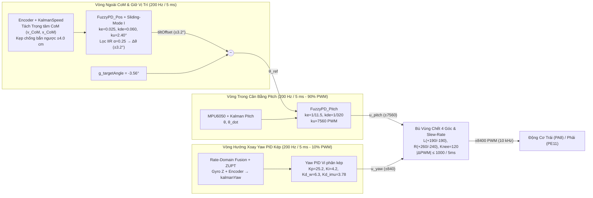

# Hệ Thống Robot Hai Bánh Tự Cân Bằng (TWIP) — STM32F407VG & FreeRTOS

[-03234B?logo=stmicroelectronics)](https://www.st.com/en/microcontrollers-microprocessors/stm32f407vg.html)
[-007ACC)](https://www.freertos.org/)
[](#3-kiến-trúc-điều-khiển-vòng-lồng-cascaded-dual-fuzzypd)
[](./luu_do_dieu_khien_fuzzy.pdf)

Dự án thiết kế và triển khai hệ thống điều khiển **Robot hai bánh tự cân bằng (Two-Wheeled Inverted Pendulum — TWIP)** thời gian thực trên vi điều khiển **STM32F407VGT6** (ARM Cortex-M4F @ 168 MHz, Hardware FPU) sử dụng hệ điều hành thời gian thực **FreeRTOS** ở tần số đồng bộ **200 Hz ($T_s = 5\text{ ms}$)**.

Hệ thống kết hợp **4 Bộ lọc Kalman 2 trạng thái** (Pitch IMU, Yaw hợp nhất trên miền vận tốc góc Rate-Domain + khóa tĩnh ZUPT, và vận tốc động học 2 bánh xe có tắt dần gia tốc $\gamma = 0.80$), khối **Tách chuyển động Trọng tâm (CoM Decoupling) & Kẹp chống bắn ngược (Anti-Slingshot)**, cùng **Kiến trúc Điều khiển Mờ Vòng Lồng Kép (Cascaded Dual-FuzzyPD Control)** gồm Vòng ngoài giữ vị trí – vận tốc (`FuzzyPD_Pos`, 200 Hz) và Vòng trong cân bằng góc chúc ngóc (`FuzzyPD_Pitch`, 200 Hz, 90% PWM) phối hợp với bộ điều khiển hướng xoay ngang vi phân kép (`Yaw PID`, 200 Hz, 10% PWM).

📄 **Tài liệu lưu đồ & tổng hợp chi tiết các giải thuật:** [`luu_do_dieu_khien_fuzzy.pdf`](./luu_do_dieu_khien_fuzzy.pdf) (Mã nguồn LaTeX: [`luu_do_dieu_khien_fuzzy.tex`](./luu_do_dieu_khien_fuzzy.tex))

---

## Mục Lục

1. [Kiến Trúc Phần Cứng & Sơ Đồ Chân (Pinout)](#1-kiến-trúc-phần-cứng--sơ-đồ-chân-pinout)
2. [Cấu Trúc Thư Mục Mã Nguồn](#2-cấu-trúc-thư-mục-mã-nguồn)
3. [Kiến Trúc Điều Khiển Vòng Lồng & Khử Giao Thoa Trọng Tâm](#3-kiến-trúc-điều-khiển-vòng-lồng--khử-giao-thoa-trọng-tâm)
4. [Thiết Kế Bộ Điều Khiển Mờ 5 Khâu (`fuzzy.c`)](#4-thiết-kế-bộ-điều-khiển-mờ-5-khâu-fuzzyc)
5. [Đa Nhiệm Thời Gian Thực (FreeRTOS Tasks), Lọc Kalman & Hợp Nhất Yaw](#5-đa-nhiệm-thời-gian-thực-freertos-tasks-lọc-kalman--hợp-nhất-yaw)
6. [Giao Thức Truyền Thông UART/DMA & Tinh Chỉnh Nóng](#6-giao-thức-truyền-thông-uartdma--tinh-chỉnh-nóng)
7. [Kết Quả Thực Nghiệm (`lan39.csv`) & Hướng Dẫn Vận Hành](#7-kết-quả-thực-nghiệm-lan39csv--hướng-dẫn-vận-hành)

---

## 1. Kiến Trúc Phần Cứng & Sơ Đồ Chân (Pinout)

### Thông số cơ khí & cảm biến
- **Vi điều khiển:** STM32F407VGT6 (168 MHz, tích hợp FPU phần cứng đơn chính xác, 32 KB FreeRTOS Heap).
- **Cảm biến quán tính (IMU):** MPU6050 giao tiếp `I2C1` (400 kHz Fast-Mode), tần số trích mẫu nội 200 Hz (`SMPLRT_DIV = 0x04`), bộ lọc thông thấp số phần cứng `DLPF = 0x03` (44 Hz Accel / 42 Hz Gyro), thang đo Gyroscope $\pm 500^\circ/\text{s}$ ($65.5\;\text{LSB}/(^\circ/\text{s})$), Accelerometer $\pm 2g$ ($16384\;\text{LSB}/g$).
- **Động cơ & Encoder:** 2 động cơ DC giảm tốc JGB37-520 có Encoder cầu phương 2 kênh A/B (`330 PPR` $\times 4 = 1320\text{ xung/vòng}$ ở chế độ `TIM_EncoderMode_TI12`, tích hợp lọc số phần cứng `IC1F = IC2F = 0x0F` và lọc cắt gai phần mềm $|\Delta N| > 45\text{ xung}/5\text{ms}$).
- **Kích thước hình học & Điểm làm việc:** Đường kính bánh xe $D = 6.5\text{ cm}$ (chu vi $C = \pi D = 20.42035\text{ cm}$, hệ số $0.01547\text{ cm/xung}$), khoảng cách hai bánh $W = 19.21\text{ cm}$, vận tốc đặt tối đa `ROBOT_MAX_SPEED_CMS = 10.0 cm/s` ($\approx 29.38\text{ RPM}$), góc cân bằng tĩnh chuẩn `g_targetAngle = -3.56°`.

### Bảng phân bổ ngoại vi và chân GPIO

| Khối Chức Năng | Ngoại Vi STM32 | Chân GPIO | Mô Tả Chi Tiết |
| :--- | :--- | :--- | :--- |
| **IMU MPU6050** | `I2C1` (400 kHz) | `PB8` (SCL), `PB9` (SDA) | Đọc 6 trục Accel/Gyro ($\pm 2g$, $\pm 500^\circ/\text{s}$), tích hợp chống treo bus (`I2C1_Recover`) |
| **PWM Động Cơ Trái** | `TIM1_CH1` (10 kHz) | `PA8` (PWM), `PC8` / `PC6` (DIR) | Độ phân giải 8400 mức (`ARR = 8399, PSC = 1` trên APB2 168 MHz), điều khiển cầu H |
| **PWM Động Cơ Phải** | `TIM1_CH2` (10 kHz) | `PE11` (PWM), `PC9` / `PC7` (DIR) | Độ phân giải 8400 mức ($\approx 0.012\%/\text{bước}$), `PC9/PC7` điều khiển chiều quay |
| **Encoder Bánh Trái** | `TIM3` (Encoder x4) | `PB4` (CH1), `PB5` (CH2) | Đếm xung phần cứng 16-bit hai cạnh lên/xuống (`1320 counts/rev`), lọc cắt gai $>45\text{ xung}/5\text{ms}$ |
| **Encoder Bánh Phải** | `TIM4` (Encoder x4) | `PB6` (CH1), `PB7` (CH2) | Đếm xung phần cứng 16-bit hai cạnh lên/xuống (`1320 counts/rev`), lọc cắt gai $>45\text{ xung}/5\text{ms}$ |
| **Telemetry / Bluetooth** | `USART3` + `DMA1_S3` | `PD8` (TX), `PD9` (RX) | Baudrate `115200 bps`; TX dùng `DMA1_Stream3` (Ch 4), RX dùng ngắt `RXNE` + Ring Buffer 128B |
| **Nút Nhấn Ngoài** | `EXTI0` – `EXTI2` | `PC0` (Start), `PC1` (Stop), `PC2` (Calib) | Ngắt ngoài sườn xuống (`Pull-Up`); `PC2` đặt cờ `s_calibPending` để chạy Calib an toàn trong Task |
| **LED Trạng Thái** | `GPIOD` | `PD12` (Xanh), `PD13` (Cam), `PD14` (Đỏ), `PD15` (Lam) | Báo trạng thái RUNNING (`PD12`), CALIB Gyro/Encoder (`PD13`), STOP/Lỗi (`PD14`), UART/Flash (`PD15`) |
| **Lưu Cấu Hình** | `FLASH Sector 11` | `0x080E0000` (128 KB) | Lưu `magic = 0x55AA2026`, `targetAngle`, `gyroOffset` và mã kiểm tra toàn vẹn `XOR Checksum` |

---

## 2. Cấu Trúc Thư Mục Mã Nguồn

```text
balance-robot/
├── MDK_ARM/
│   ├── main.c                        # Điểm vào chương trình, cấu hình FuzzyPD_Pitch & FuzzyPD_Pos, chạy FreeRTOS
│   └── template.uvprojx              # Project Keil MDK-ARM uVision 5 (kèm Objects/ & Listings/)
├── MY_LIB/
│   ├── fuzzy.c / fuzzy.h             # Bộ điều khiển Mờ PD 5 khâu chuẩn hóa (FuzzyController_t, FuzzyPD_Compute)
│   ├── kalman.c / kalman.h           # 4 bộ lọc Kalman 2 trạng thái: góc nghiêng (Pitch/Yaw) & vận tốc bánh xe (γ=0.80)
│   ├── pid.c / pid.h                 # Bộ điều khiển PID số (dạng vị trí & gia số) cho Yaw PID và chế độ Dual-PID
│   ├── managetask.c / managetask.h   # 4 Task FreeRTOS 200 Hz, CoM Decoupling, Rate-Domain Yaw Fusion & giao thức UART
│   ├── driver_i2c.c / driver_i2c.h   # Driver I2C1 phần cứng (PB8/PB9), Bus Recovery & cấu hình DLPF MPU6050
│   ├── driver_uart.c / driver_uart.h # Driver USART3 (PD8/PD9) kết hợp DMA1_Stream3 TX và Ring Buffer RX
│   ├── driver_flash.c / driver_flash.h # Lưu/đọc cấu hình hiệu chuẩn vào bộ nhớ Flash nội (Sector 11 - 0x080E0000)
│   ├── encoder.c / encoder.h         # Đọc xung Encoder TIM3/TIM4 (1320 PPR), lọc số IC1F/IC2F & lọc cắt gai phần mềm
│   ├── motor.c / motor.h             # Điều chế xung PWM TIM1 10 kHz (PA8/PE11, thang ±8400) và điều khiển chiều
│   └── gpio.c / gpio.h               # Cấu hình 4 LED chỉ thị (PD12..15) và ngắt ngoài EXTI0..2 (PC0..2)
├── FreeRTOS/                         # Nhân hệ điều hành thời gian thực FreeRTOS v11.1 (ARM Cortex-M4F port)
├── Libraries/                        # Thư viện CMSIS & STM32F4xx Standard Peripheral Driver
├── lan20.csv .. lan39.csv            # Bộ dữ liệu Telemetry thực nghiệm 50 Hz trên phần cứng thực tế
├── luu_do_dieu_khien_fuzzy.tex       # Mã nguồn LaTeX tài liệu tổng hợp giải thuật & bộ lọc
├── luu_do_dieu_khien_fuzzy.pdf       # Bản PDF lưu đồ kiến trúc, 29 phương trình giải thuật & đồ thị thực nghiệm lan39
└── README.md                         # Tài liệu hướng dẫn tổng quan dự án
```

---

## 3. Kiến Trúc Điều Khiển Vòng Lồng & Khử Giao Thoa Trọng Tâm



### Các bộ lọc xử lý vòng ngoài & tầng công suất trong `vTaskControl` (200 Hz)
1. **Tách vận tốc & vị trí Trọng tâm (`CoM Decoupling`):**
   - Khử vận tốc lắc thân xe khỏi vận tốc bánh xe: $v_{\text{CoM,raw}} = v_{\text{wheel}} - 0.42 \cdot \text{clamp}(\dot{\theta}, -60^\circ/\text{s}, +60^\circ/\text{s})$, sau đó lọc thông thấp IIR bậc 1 với $\alpha_v = 0.22$ ($f_c \approx 8\text{ Hz}$).
   - Bù dịch chuyển vị trí trọng tâm theo góc nghiêng: $x_{\text{CoM}} = x_{\text{fw}} - 0.15 \cdot (\hat{\theta} - \theta_{\text{base}})$.
2. **Bộ kẹp Chống Bắn Ngược (`Anti-Slingshot Clamping` & `Brake-in-Place`):**
   - Khi đang lái: kẹp điểm đích bám theo xe trong phạm vi `POS_TARGET_LEAD_MAX_CM = 12.0 cm`.
   - Khi vừa nhả tay lái: chốt tức thời $x_{\text{target}} = x_{\text{CoM}}$ giúp xe phanh đứng tại chỗ, không giật lùi về gốc cũ.
   - Khi đứng yên bị ngoại lực đẩy mạnh: kẹp `POS_HOLD_MAX_ERR_CM = 4.0 cm` để điểm đích trượt theo chân xe, giúp xe hãm mượt vận tốc $v_{\text{CoM}}$ về 0 mà không bị bắn ngược ngã ngửa.
3. **Tự động học góc cân bằng tĩnh theo Mặt trượt (`Sliding-Mode Auto-Trim`):**
   - Mặt trượt $s_{\text{pos}} = e_{\text{pos}} + 1.2 \cdot v_{\text{CoM,cms}}$; chỉ tích phân khi $e_{\text{pos}} \cdot s_{\text{pos}} > 0$ (`POS_INTEGRAL_KI = 0.004`, giới hạn $\pm 1.20^\circ$).
4. **Bù vùng chết 4 góc phần tư có độ dốc mềm (`4-Quadrant Soft-Knee Deadband`) & `Slew-Rate Limiter`:**
   - Ngưỡng đo thực nghiệm từ công cụ Dò vùng chết: Bánh Trái `+190 / -190 PWM`, Bánh Phải `+260 / -240 PWM`, đoạn dốc tuyến tính `U_knee = 120 PWM` và giới hạn đạo hàm xung `1000 PWM / 5ms`.

---

## 4. Thiết Kế Bộ Điều Khiển Mờ 5 Khâu (`fuzzy.c`)

Thư viện [`MY_LIB/fuzzy.c`](./MY_LIB/fuzzy.c) cài đặt cấu trúc `FuzzyController_t` và hàm `FuzzyPD_Compute()` gồm **5 khâu xử lý chuẩn hóa** (chuẩn hóa & kẹp $[-1, +1]$ $\rightarrow$ mờ hóa 5 tập $\{\text{NB, NS, ZE, PS, PB}\}$ với đáy phẳng $\pm z_e$ $\rightarrow$ suy diễn tích đại số Larsen 25 luật $\rightarrow$ giải mờ trung bình có trọng số 7 vạch Singleton & kẹp $[-1, +1]$ $\rightarrow$ nhân $k_u$):

| Tham Số Cấu Hình (`MDK_ARM/main.c`) | `FuzzyPD_Pitch` (Vòng Trong — 200 Hz) | `FuzzyPD_Pos` (Vòng Ngoài — 200 Hz) |
| :--- | :--- | :--- |
| **Hệ số chuẩn hóa sai số $k_e$** | $1/11.5 \approx 0.08696\;\text{độ}^{-1}$ (bão hòa $\pm 11.5^\circ$) | $0.025\;\text{cm}^{-1}$ (bão hòa $\pm 40.0\text{ cm}$) |
| **Hệ số chuẩn hóa đạo hàm $k_{de}$** | $1/320 = 0.003125\;(\text{độ/s})^{-1}$ (bão hòa $\pm 320^\circ/\text{s}$) | $0.060\;(\text{cm/s})^{-1}$ (bão hòa $\pm 16.7\text{ cm/s}$) |
| **Hệ số khuếch đại hậu xử lý $k_u$** | $7560.0\text{ PWM}$ (90% công suất cầu H) | $2.40^\circ$ (tổng sau cộng tích phân kẹp $\pm 3.20^\circ$) |
| **Mốc hàm liên thuộc $e$ (`NB, NS, ZE`)** | `(0.46, 0.20, 0.002)` | `(0.44, 0.16, 0.002)` |
| **Mốc hàm liên thuộc $de$ (`NB, NS, ZE`)** | `(0.46, 0.20, 0.005)` | `(0.46, 0.18, 0.010)` |
| **Singleton đầu ra (`u_small, u_med`)** | `(0.25, 0.65)` | `(0.26, 0.62)` |
| **Độ lợi tuyến tính tương đương vùng tâm** | $K_p \approx 822\text{ PWM/}^\circ,\; K_d \approx 29.5\text{ PWM/(}^\circ\text{/s)}$ | $K_p \approx 0.098^\circ/\text{cm},\; K_d \approx 0.208^\circ/(\text{cm/s})$ |

---

## 5. Đa Nhiệm Thời Gian Thực (FreeRTOS Tasks), Lọc Kalman & Hợp Nhất Yaw

| Tên Task | Độ Ưu Tiên | Chu Kỳ ($f_s$) | Stack | Chức Năng Thực Thi Chính |
| :--- | :---: | :---: | :---: | :--- |
| `vTaskControl` | **4 (Cao nhất)** | $5\text{ ms}$ ($200\text{ Hz}$) | 1024 W | Tách `CoM`, chạy vòng ngoài `FuzzyPD_Pos`, tự học góc tĩnh, vòng trong `FuzzyPD_Pitch`, `Yaw PID` kép, bù vùng chết & Slew-Rate |
| `vTaskIMU` | **3** | $5\text{ ms}$ ($200\text{ Hz}$) | 512 W | Đọc MPU6050 qua `I2C1`, tự hiệu chuẩn `ZUPT` điểm 0 Gyro Z (`0.995/0.005`), hợp nhất vận tốc góc Yaw 3 chế độ và lọc `kalmanPitch`, `kalmanYaw` ($Q_\theta=0.001, Q_b=0.003, R=0.03$) |
| `vTaskEncoder` | **3** | $5\text{ ms}$ ($200\text{ Hz}$) | 512 W | Đọc `TIM3`/`TIM4`, lọc cắt gai, tích lũy Odometry và lọc vận tốc qua `kalmanSpeed_L/R` ($Q_v=0.40, Q_a=50.0, R=5.0, \gamma=0.80$) |
| `vTaskUART` | **2** | $10\text{ ms}$ ($100\text{ Hz}$) | 512 W | Xử lý `Robot_AutoCalibrate()`, giải mã lệnh điều khiển kiểm tra `XOR Checksum` và phát Telemetry 88-byte bằng DMA ở $50\text{ Hz}$ |

---

## 6. Giao Thức Truyền Thông UART/DMA & Tinh Chỉnh Nóng

Khung truyền nhị phân tốc độ cao trên `USART3` (`115200 bps`):
```text
[Header: 0xAA] [ID: 1 byte] [Length: 1 byte] [Payload: N bytes] [Checksum: 1 byte] [Tail: 0xFF]
```
*(Trong đó `Checksum = ID ^ Length ^ Data[0] ^ ... ^ Data[N-1]` — phép XOR bit)*

- **Gói gửi lên PC:** `ID = 0x01` (`RobotTelemetry_t` — 88 bytes = 22 biến `float`, 50 Hz) và `ID = 0x02` (`RobotConfigSync_t` — 64 bytes = 16 biến `float`).
- **Các lệnh từ PC xuống STM32:** `0x01` (START), `0x02` (STOP), `0x03` (AUTO CALIB lưu Flash Sector 11), `0x04` (Góc cân bằng `g_targetAngle`), `0x05` (Vận tốc đặt), `0x06` (Góc hướng đích `g_targetYaw` / Reset gốc), `0x07` (Chế độ Dual-PID / Fuzzy), `0x08` (Cập nhật PID), `0x09` (Đồng bộ cấu hình), `0x0A` (Nạp nóng 6 hệ số Fuzzy `(ke, kde, ku)`), `0x0B` (Chạy dò vùng chết động cơ tự động).

---

## 7. Kết Quả Thực Nghiệm (`lan39.csv`) & Hướng Dẫn Vận Hành

### Tổng kết chất lượng thực nghiệm (`lan39.csv` — 8.063 mẫu, 403 giây liên tục tại `g_targetAngle = -3.56°`)
- **Độ ổn định góc Pitch khi đứng yên:** $\sigma_{\text{pitch}} = 0.11^\circ$ (đỉnh-đỉnh $0.51^\circ$, sai lệch tĩnh trung bình $< 0.05^\circ$).
- **Độ chính xác khóa vị trí tại chỗ:** $\sigma_v = 0.70\text{ cm/s}$, độ trôi vị trí $\Delta x \le \pm 0.2\text{ cm}$ ($\pm 2\text{ mm}$).
- **Khả năng kháng nhiễu đẩy mạnh liên tiếp (Push Recovery):** Chịu được các cú đẩy ngoại lực mạnh liên tiếp tới vận tốc đỉnh **$78.9\text{ cm/s}$**, tự động hồi phục cân bằng 100% sau $1.2\text{ – }1.8\text{ s}$ mà không bị bắn ngược (0 lần ngã).
- **Độ ổn định hướng xoay Yaw:** Độ trôi tĩnh $0.000^\circ/\text{s}$ (sai số $< 0.08^\circ$), không bị kéo ngược khi có ngoại lực xoay thân xe.

### Biên dịch và nạp chương trình
1. Mở project [`MDK_ARM/template.uvprojx`](./MDK_ARM/template.uvprojx) bằng **Keil MDK-ARM uVision 5** (hoặc biên dịch dòng lệnh):
   ```powershell
   C:\Keil_v5\UV4\UV4.exe -b MDK_ARM\template.uvprojx -j0
   ```
2. Nạp qua **ST-Link V2** (chọn **Erase Sectors** thay vì Erase Full Chip để bảo toàn dữ liệu hiệu chuẩn ở `Flash Sector 11` — `0x080E0000`).
