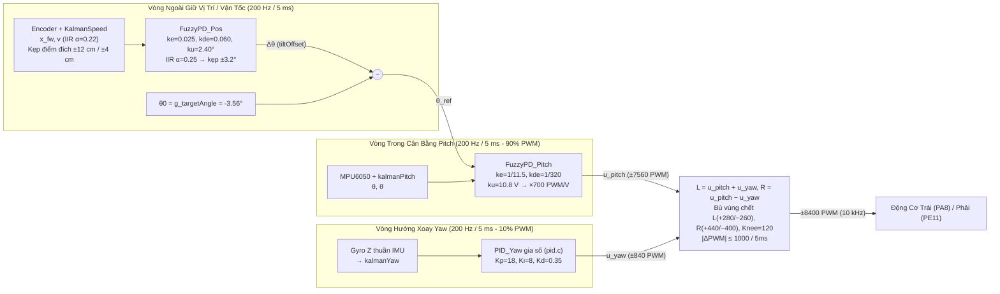

# Hệ Thống Robot Hai Bánh Tự Cân Bằng (TWIP) — STM32F407VG & FreeRTOS

[-03234B?logo=stmicroelectronics)](https://www.st.com/en/microcontrollers-microprocessors/stm32f407vg.html)
[-007ACC)](https://www.freertos.org/)
[](#3-kiến-trúc-điều-khiển-vòng-lồng-cascaded-dual-fuzzypd)
[](./luu_do_dieu_khien_fuzzy.pdf)

Dự án thiết kế và triển khai hệ thống điều khiển **Robot hai bánh tự cân bằng (Two-Wheeled Inverted Pendulum — TWIP)** thời gian thực trên vi điều khiển **STM32F407VGT6** (ARM Cortex-M4F @ 168 MHz, Hardware FPU) sử dụng hệ điều hành thời gian thực **FreeRTOS** ở tần số đồng bộ **200 Hz ($T_s = 5\text{ ms}$)**.

Hệ thống gồm **4 bộ lọc Kalman 2 trạng thái** (góc Pitch, góc Yaw thuần IMU và vận tốc 2 bánh xe có tắt dần gia tốc $\gamma = 0.80$), khối **kẹp điểm đích chống bắn ngược (Anti-Slingshot)**, cùng **kiến trúc điều khiển mờ vòng lồng kép (Cascaded Dual-FuzzyPD)**: vòng ngoài giữ vị trí – vận tốc (`FuzzyPD_Pos`) sinh góc nghiêng đặt cho vòng trong cân bằng góc chúc ngóc (`FuzzyPD_Pitch`, đầu ra điện áp, 90% PWM), phối hợp với bộ **PID gia số giữ hướng xoay** (`PID_Yaw`, 10% PWM). Cả 3 vòng chạy ở 200 Hz.

📄 **Tài liệu lưu đồ & tổng hợp giải thuật:** [`luu_do_dieu_khien_fuzzy.pdf`](./luu_do_dieu_khien_fuzzy.pdf) (mã nguồn LaTeX: [`luu_do_dieu_khien_fuzzy.tex`](./luu_do_dieu_khien_fuzzy.tex)).
> ⚠️ Tài liệu PDF/LaTeX được viết cho **phiên bản firmware trước** (còn CoM Decoupling, Rate-Domain Yaw Fusion, Sliding-Mode Auto-Trim và Yaw PID vi phân kép). README này mô tả đúng mã nguồn hiện tại.

---

## Mục Lục

1. [Kiến Trúc Phần Cứng & Sơ Đồ Chân (Pinout)](#1-kiến-trúc-phần-cứng--sơ-đồ-chân-pinout)
2. [Cấu Trúc Thư Mục Mã Nguồn](#2-cấu-trúc-thư-mục-mã-nguồn)
3. [Kiến Trúc Điều Khiển Vòng Lồng (Cascaded Dual-FuzzyPD)](#3-kiến-trúc-điều-khiển-vòng-lồng-cascaded-dual-fuzzypd)
4. [Thiết Kế Bộ Điều Khiển Mờ 5 Khâu (`fuzzy.c`)](#4-thiết-kế-bộ-điều-khiển-mờ-5-khâu-fuzzyc)
5. [Đa Nhiệm Thời Gian Thực (FreeRTOS Tasks) & Lọc Kalman](#5-đa-nhiệm-thời-gian-thực-freertos-tasks--lọc-kalman)
6. [Giao Thức Truyền Thông UART/DMA & Tinh Chỉnh Nóng](#6-giao-thức-truyền-thông-uartdma--tinh-chỉnh-nóng)
7. [Kết Quả Thực Nghiệm & Hướng Dẫn Vận Hành](#7-kết-quả-thực-nghiệm--hướng-dẫn-vận-hành)

---

## 1. Kiến Trúc Phần Cứng & Sơ Đồ Chân (Pinout)

### Thông số cơ khí & cảm biến
- **Vi điều khiển:** STM32F407VGT6 (168 MHz, tích hợp FPU phần cứng đơn chính xác, 32 KB FreeRTOS Heap).
- **Cảm biến quán tính (IMU):** MPU6050 giao tiếp `I2C1` (400 kHz Fast-Mode), tần số trích mẫu nội 200 Hz (`SMPLRT_DIV = 0x04`), bộ lọc thông thấp số phần cứng `DLPF = 0x03` (44 Hz Accel / 42 Hz Gyro), thang đo Gyroscope $\pm 500^\circ/\text{s}$ ($65.5\;\text{LSB}/(^\circ/\text{s})$), Accelerometer $\pm 2g$ ($16384\;\text{LSB}/g$).
- **Động cơ & Encoder:** 2 động cơ DC giảm tốc JGB37-520 có Encoder cầu phương 2 kênh A/B (`330 PPR` $\times 4 = 1320\text{ xung/vòng}$ ở chế độ `TIM_EncoderMode_TI12`, tích hợp lọc số phần cứng `IC1F = IC2F = 0x0F` và lọc cắt gai phần mềm $|\Delta N| > 45\text{ xung}/5\text{ms}$). Cả 2 encoder được đảo chiều đếm (`ENCODER_LEFT/RIGHT_INVERT = 1`) để thống nhất quy ước **xe chạy tiến = dương (+)**.
- **Kích thước hình học & Điểm làm việc:** Đường kính bánh xe $D = 6.5\text{ cm}$ (chu vi $C = \pi D = 20.42035\text{ cm}$, hệ số $0.01547\text{ cm/xung}$), khoảng cách hai bánh $W = 19.21\text{ cm}$, vận tốc đặt tối đa `ROBOT_MAX_SPEED_CMS = 10.0 cm/s` ($\approx 29.38\text{ RPM}$), góc cân bằng tĩnh mặc định `g_targetAngle = -3.56°`.

### Bảng phân bổ ngoại vi và chân GPIO

| Khối Chức Năng | Ngoại Vi STM32 | Chân GPIO | Mô Tả Chi Tiết |
| :--- | :--- | :--- | :--- |
| **IMU MPU6050** | `I2C1` (400 kHz) | `PB8` (SCL), `PB9` (SDA) | Đọc 6 trục Accel/Gyro ($\pm 2g$, $\pm 500^\circ/\text{s}$), tích hợp chống treo bus (`I2C1_Recover`) |
| **PWM Động Cơ Trái** | `TIM1_CH1` (10 kHz) | `PA8` (PWM), `PC8` / `PC6` (DIR) | Độ phân giải 8400 mức (`ARR = 8399, PSC = 1` trên APB2 168 MHz), điều khiển cầu H |
| **PWM Động Cơ Phải** | `TIM1_CH2` (10 kHz) | `PE11` (PWM), `PC9` / `PC7` (DIR) | Độ phân giải 8400 mức ($\approx 0.012\%/\text{bước}$), đảo chiều bằng phần mềm (`MOTOR_RIGHT_INVERT = 1`) |
| **Encoder Bánh Trái** | `TIM3` (Encoder x4) | `PB4` (CH1), `PB5` (CH2) | Đếm xung phần cứng 16-bit hai cạnh lên/xuống (`1320 counts/rev`), lọc cắt gai $>45\text{ xung}/5\text{ms}$ |
| **Encoder Bánh Phải** | `TIM4` (Encoder x4) | `PB6` (CH1), `PB7` (CH2) | Đếm xung phần cứng 16-bit hai cạnh lên/xuống (`1320 counts/rev`), lọc cắt gai $>45\text{ xung}/5\text{ms}$ |
| **Telemetry / Bluetooth** | `USART3` + `DMA1_S3` | `PD8` (TX), `PD9` (RX) | Baudrate `115200 bps`; TX dùng `DMA1_Stream3` (Ch 4), RX dùng ngắt `RXNE` + Ring Buffer 128B |
| **Nút Nhấn Ngoài** | `EXTI0` – `EXTI2` | `PC0` (Start), `PC1` (Stop), `PC2` (Calib) | Ngắt ngoài sườn xuống (`Pull-Up`); `PC2` đặt cờ `s_calibPending` để chạy Calib an toàn trong Task |
| **LED Trạng Thái** | `GPIOD` | `PD12` (Xanh), `PD13` (Cam), `PD14` (Đỏ), `PD15` (Lam) | RUNNING (`PD12` nháy), nhịp Encoder / Calib Gyro (`PD13`), STOP / Lỗi (`PD14`), nhịp UART / Calib góc (`PD15`) |

---

## 2. Cấu Trúc Thư Mục Mã Nguồn

```text
Firmware/
├── MDK_ARM/
│   ├── main.c                        # Điểm vào chương trình, khởi tạo FuzzyPD_Pitch, FuzzyPD_Pos, PID_Yaw & chạy FreeRTOS
│   └── template.uvprojx              # Project Keil MDK-ARM uVision 5 (ARMCC 5.06, C99, kèm Objects/ & Listings/)
├── MY_LIB/
│   ├── fuzzy.c / fuzzy.h             # Bộ điều khiển Fuzzy PD 5 khâu (Sugeno bậc 0): FuzzyController_t, FuzzyPD_Compute
│   ├── kalman.c / kalman.h           # 4 bộ lọc Kalman 2 trạng thái: góc (Pitch/Yaw) & vận tốc bánh xe (γ=0.80)
│   ├── pid.c / pid.h                 # PID số dạng gia số (velocity form, tích phân hình thang) cho PID_Yaw
│   ├── managetask.c / managetask.h   # 4 Task FreeRTOS, vòng lồng điều khiển, bù vùng chết, Calib & giao thức UART
│   ├── driver_i2c.c / driver_i2c.h   # Driver I2C1 phần cứng (PB8/PB9), Bus Recovery & cấu hình DLPF MPU6050
│   ├── driver_uart.c / driver_uart.h # Driver USART3 (PD8/PD9) kết hợp DMA1_Stream3 TX và Ring Buffer RX
│   ├── encoder.c / encoder.h         # Đọc xung Encoder TIM3/TIM4 (1320 PPR), lọc số IC1F/IC2F & lọc cắt gai phần mềm
│   ├── motor.c / motor.h             # Điều chế xung PWM TIM1 10 kHz (PA8/PE11, thang ±8400), quy đổi điện áp → PWM
│   └── gpio.c / gpio.h               # Cấu hình 4 LED chỉ thị (PD12..15) và ngắt ngoài EXTI0..2 (PC0..2)
├── FreeRTOS/                         # Nhân hệ điều hành thời gian thực FreeRTOS v11.1 (ARM Cortex-M4F port)
├── Libraries/                        # Thư viện CMSIS & STM32F4xx Standard Peripheral Driver
├── lan1.csv                          # Log Telemetry 50 Hz dùng để đo ngưỡng vùng chết động cơ (lệnh 0x0B)
├── luu_do_dieu_khien_fuzzy.tex/.pdf  # Tài liệu lưu đồ & giải thuật (viết cho phiên bản firmware trước)
└── README.md                         # Tài liệu này
```

---

## 3. Kiến Trúc Điều Khiển Vòng Lồng (Cascaded Dual-FuzzyPD)



### Trình tự xử lý trong `vTaskControl` (mỗi 5 ms)
1. **Bảo vệ:** nếu $|\theta - \theta_0| > 15^\circ$ (`ROBOT_BALANCE_ANGLE_LIMIT`) → `Robot_Stop()` ngắt động cơ.
2. **Vận tốc & vị trí bánh xe:** $v = \tfrac{1}{2}(v_L + v_R)$ lấy từ `kalmanSpeed_L/R`, lọc thông thấp IIR bậc 1 $\alpha_v = 0.22$; vị trí $x_{\text{fw}} = \tfrac{1}{2}(N_L + N_R)\cdot 0.01547\text{ cm}$ tính từ tổng xung encoder kể từ lần reset gốc.
3. **Điểm đích vị trí & chống bắn ngược (`Anti-Slingshot Clamping` & `Brake-in-Place`):**
   - Khi đang lái ($|v_{\text{cmd}}| > 0.1\text{ RPM}$): $x_{\text{target}} \mathrel{+}= v_{\text{cmd}} T_s$, kẹp trong $x_{\text{fw}} \pm 12\text{ cm}$ (`POS_TARGET_LEAD_MAX_CM`).
   - Khi vừa nhả lệnh lái: chốt $x_{\text{target}} = x_{\text{fw}}$ để xe phanh tại chỗ, không giật lùi về gốc cũ.
   - Khi đứng yên bị đẩy: kẹp $x_{\text{target}}$ trong $x_{\text{fw}} \pm 4\text{ cm}$ (`POS_HOLD_MAX_ERR_CM`) để điểm đích trượt theo xe, ưu tiên hãm vận tốc về 0.
4. **Vòng ngoài:** $e_{\text{pos}} = x_{\text{fw}} - x_{\text{target}}$ (cm), $de_{\text{pos}} = v - v_{\text{cmd}}$ (cm/s, kẹp $\pm 30$). Đầu ra `FuzzyPD_Pos` qua IIR $\alpha = 0.25$, kẹp $\pm 3.2^\circ$ (`CASCADE_MAX_TOTAL_TILT_DEG`) thành $\Delta\theta$; góc đặt vòng trong $\theta_{\text{ref}} = \theta_0 - \Delta\theta$.
5. **Vòng trong:** $u_{\text{pitch}} = $ `FuzzyPD_Pitch`$(\theta_{\text{ref}}, \theta, \dot\theta)$ (V), kẹp $\pm 10.8\text{ V}$ (`VOLTAGE_LIMIT_BALANCE`, vì $k_u$ có thể bị nạp nóng), quy đổi $\text{PWM} = u \cdot 8400/12$ và kẹp $\pm 7560$.
6. **Vòng Yaw:** góc đặt $\psi_{\text{ref}}$ tiến dần tới `g_targetYaw` tối đa $0.25^\circ$/chu kỳ ($50^\circ/\text{s}$). `PID_Yaw` dạng gia số, kẹp $\pm 840$ PWM:
   $$\Delta u_k = K_p(e_k - e_{k-1}) + \tfrac{K_i T_s}{2}(e_k + e_{k-1}) + \tfrac{K_d}{T_s}(e_k - 2e_{k-1} + e_{k-2}),\qquad u_k = \text{sat}(u_{k-1} + \Delta u_k)$$
7. **Bù vùng chết bất đối xứng có đoạn dốc mềm (`Soft-Knee Deadband`) & `Slew-Rate Limiter`:**
   $$u' = u + \text{sgn}(u)\cdot DB_{\pm}\cdot\min\!\left(1, \tfrac{|u|}{U_{\text{knee}}}\right),\qquad u' = 0 \text{ khi } |u| < 1$$
   với $DB$ (≈ 80% ngưỡng dừng quay đo từ `lan1.csv`): Bánh Trái `+280 / −260 PWM`, Bánh Phải `+440 / −400 PWM`, $U_{\text{knee}} = 120\text{ PWM}$. Sau đó kẹp $\pm 8400$ và giới hạn bước nhảy $|\Delta\text{PWM}| \le 1000$ mỗi 5 ms.

---

## 4. Thiết Kế Bộ Điều Khiển Mờ 5 Khâu (`fuzzy.c`)

Thư viện [`MY_LIB/fuzzy.c`](./MY_LIB/fuzzy.c) cài đặt bộ **Fuzzy PD kiểu Sugeno bậc 0** (2 đầu vào × 5 tập, 25 luật, đầu ra 7 singleton), dùng chung cho cả 2 vòng qua cấu trúc `FuzzyController_t` và hàm `FuzzyPD_Compute()`. Tương đương một FIS trong MATLAB với `AndMethod = prod` và `DefuzzificationMethod = wtaver`.

### 4.1. Năm khâu xử lý

| Khâu | Công thức (trong `FuzzyPD_Compute()`) |
| :--- | :--- |
| **1. Tiền xử lý** | $e = y - r$ (đo − đặt), $\;e_n = \text{sat}(k_e\,e),\; de_n = \text{sat}(k_{de}\,de)$, với $\text{sat}$ = kẹp về $[-1, +1]$ |
| **2. Mờ hóa** | 5 tập $\{\text{NB, NS, ZE, PS, PB}\}$ cho mỗi đầu vào (mục 4.2) |
| **3. Suy diễn** | 25 luật, toán tử AND là tích đại số: $w_{ij} = \mu_i(e_n)\cdot\mu_j(de_n)$ |
| **4. Giải mờ** | Trung bình có trọng số 7 singleton: $u_n = \dfrac{\sum_{i,j} w_{ij}\, U_{R(i,j)}}{\sum_{i,j} w_{ij}} \in [-1, +1]$ |
| **5. Hậu xử lý** | $u = k_u \cdot u_n \in [-k_u, +k_u]$ |

Ý nghĩa đầu vào/đầu ra của từng vòng:

| Bộ điều khiển | $e$ | $de$ | $u$ |
| :--- | :--- | :--- | :--- |
| `FuzzyPD_Pitch` | $\theta - \theta_{\text{ref}}$ (°) | $\dot\theta$ từ gyro đã trừ bias Kalman (°/s) | Điện áp động cơ (V) |
| `FuzzyPD_Pos` | $x_{\text{fw}} - x_{\text{target}}$ (cm) | $v - v_{\text{cmd}}$ (cm/s) | Góc nghiêng bù $\Delta\theta$ (°) |

> **Quy ước dấu:** sai số lấy theo **đo − đặt** (ngược thông lệ $r - y$), nhất quán với bảng luật và dấu của cơ cấu chấp hành. Với vòng Pitch, $de$ là đạo hàm của **đại lượng đo** ($\dot\theta$) chứ không phải của sai số, nên khi vòng ngoài thay đổi $\theta_{\text{ref}}$ đầu ra không bị giật (không có *derivative kick*).

### 4.2. Hàm liên thuộc đầu vào

Đỉnh 5 tập đặt tại $\{-NB, -NS, 0, +NS, +NB\}$ trên miền chuẩn hóa $[-1, +1]$:

| Tập | Dạng | Điểm đặc trưng |
| :---: | :--- | :--- |
| NB | Hình thang vai trái | $= 1$ khi $x \le -NB$, giảm về 0 tại $-NS$ |
| NS | Tam giác | $(-NB,\; -NS,\; 0)$ |
| ZE | Tam giác | $(-NS,\; 0,\; +NS)$ |
| PS | Tam giác | $(0,\; +NS,\; +NB)$ |
| PB | Hình thang vai phải | tăng từ $+NS$, $= 1$ khi $x \ge +NB$ |

Đây là **phân hoạch chuẩn**: tại mọi $x$ có tối đa 2 tập kề nhau khác 0 và $\sum\mu = 1$ (yêu cầu $0 < NS < NB \le 1$).

### 4.3. Bảng luật & singleton đầu ra

Cả 2 bộ điều khiển dùng chung bảng `FUZZY_RULE_PD` (có thể truyền bảng riêng qua tham số cuối của `Fuzzy_Init`):

| $u$ | $de$ = NB | NS | ZE | PS | PB |
| :---: | :---: | :---: | :---: | :---: | :---: |
| **$e$ = NB** | NB | NB | NM | NS | ZE |
| **NS** | NB | NM | NS | ZE | PS |
| **ZE** | NM | NS | ZE | PS | PM |
| **PS** | NS | ZE | PS | PM | PB |
| **PB** | ZE | PS | PM | PB | PB |

- Bảng **đối xứng lẻ** qua tâm: $u(-e, -de) = -u(e, de)$.
- **Đường chéo phụ** ($e_n = -de_n$) cho $u = \text{ZE}$: sai số đang tự giảm đúng tốc độ thì không cần can thiệp.
- 7 singleton đầu ra: $U = \{-1,\; -U_M,\; -U_S,\; 0,\; +U_S,\; +U_M,\; +1\}$ cho $\{\text{NB, NM, NS, ZE, PS, PM, PB}\}$.

### 4.4. Tham số cấu hình (`MDK_ARM/main.c`)

| Tham số | `FuzzyPD_Pitch` (vòng trong) | `FuzzyPD_Pos` (vòng ngoài) |
| :--- | :--- | :--- |
| **Hệ số chuẩn hóa sai số $k_e$** | $1/11.5 \approx 0.08696\;\text{độ}^{-1}$ (bão hòa $\pm 11.5^\circ$) | $0.025\;\text{cm}^{-1}$ (bão hòa $\pm 40\text{ cm}$) |
| **Hệ số chuẩn hóa đạo hàm $k_{de}$** | $1/320 = 0.003125\;(\text{độ/s})^{-1}$ (bão hòa $\pm 320^\circ/\text{s}$) | $0.060\;(\text{cm/s})^{-1}$ (bão hòa $\pm 16.7\text{ cm/s}$) |
| **Hệ số khuếch đại đầu ra $k_u$** | $10.8\text{ V}$ (90% của 12 V $\approx 7560$ PWM) | $2.40^\circ$ (sau lọc IIR kẹp $\pm 3.2^\circ$) |
| **Đỉnh tập của $e$ (`NB, NS`)** | `(0.46, 0.20)` | `(0.44, 0.16)` |
| **Đỉnh tập của $de$ (`NB, NS`)** | `(0.46, 0.20)` | `(0.46, 0.18)` |
| **Singleton đầu ra ($U_S, U_M$)** | `(0.25, 0.65)` | `(0.26, 0.62)` |
| **Độ lợi PD tương đương vùng tâm** | $K_p \approx 1.174\text{ V}/^\circ$ ($\approx 822$ PWM/°) <br/> $K_d \approx 0.0422\text{ V}/(^\circ/\text{s})$ ($\approx 29.5$ PWM/(°/s)) | $K_p \approx 0.098^\circ/\text{cm}$ <br/> $K_d \approx 0.208^\circ/(\text{cm/s})$ |

Hệ số $k_e, k_{de}, k_u$ của cả 2 bộ có thể nạp nóng từ GUI (lệnh `0x0A`).

### 4.5. Tính chất của bộ điều khiển

- **Mặt điều khiển là nội suy song tuyến tính của bảng luật.** Do phân hoạch chuẩn và AND = tích nên $\sum w_{ij} = (\sum\mu_e)(\sum\mu_{de}) = 1$; đầu ra là tổ hợp lồi của các singleton, nên luôn nằm trong $[-k_u, +k_u]$, đơn điệu theo $e$, $de$ và đối xứng lẻ.
- **Độ lợi tương đương vùng tâm** ($|e_n| \le NS_e$, $|de_n| \le NS_{de}$, bỏ qua số hạng chéo nhỏ):
  $$u \approx \underbrace{k_u k_e \tfrac{U_S}{NS_e}}_{K_p}\, e + \underbrace{k_u k_{de} \tfrac{U_S}{NS_{de}}}_{K_d}\, de$$
  Ra khỏi vùng tâm, độ lợi thay đổi theo bảng luật (phi tuyến) và bão hòa ở $\pm k_u$.
- **Bộ điều khiển không có trạng thái nội** (không tích phân), nên `Fuzzy_Reset()` chỉ xóa giá trị telemetry `e_norm`, `de_norm`.
- **An toàn số học:** đầu vào NaN cho mọi $\mu = 0$, khi đó $\sum w = 0$ và đầu ra $u = 0$; đầu vào $\pm\infty$ bị bão hòa về $\pm 1$.
- **Vòng ngoài chủ yếu làm việc ở vùng tâm:** do kẹp điểm đích, $|e_{\text{pos}}| \le 12\text{ cm}$ khi lái ($|e_n| \le 0.30$) và $\le 4\text{ cm}$ khi đứng yên ($|e_n| \le 0.10$), đều nhỏ hơn $NB = 0.44$. Vì vậy hai hàng NB/PB theo $e$ của bảng luật không được kích hoạt: vòng ngoài kéo vị trí nhẹ và ưu tiên phanh theo $de$.

---

## 5. Đa Nhiệm Thời Gian Thực (FreeRTOS Tasks) & Lọc Kalman

| Tên Task | Độ Ưu Tiên | Chu Kỳ ($f_s$) | Stack | Chức Năng Thực Thi Chính |
| :--- | :---: | :---: | :---: | :--- |
| `vTaskControl` | **4 (Cao nhất)** | $5\text{ ms}$ ($200\text{ Hz}$) | 1024 W | Vòng ngoài `FuzzyPD_Pos`, vòng trong `FuzzyPD_Pitch`, `PID_Yaw`, bù vùng chết & Slew-Rate, bảo vệ $\pm 15^\circ$; khi STOP thì chạy lệnh thử PWM (`0x0B`) |
| `vTaskIMU` | **3** | $5\text{ ms}$ ($200\text{ Hz}$) | 512 W | Đọc MPU6050 qua `I2C1`; góc Pitch từ Accel $\theta_{\text{acc}} = \text{atan2}(-a_x, \sqrt{a_y^2 + a_z^2})$; lọc `kalmanPitch` ($Q_\theta=0.001, Q_b=0.003, R=0.03$); Yaw thuần IMU: tích phân Gyro Z (bỏ qua $|\dot\psi| < 1.5^\circ/\text{s}$) rồi lọc `kalmanYaw`; tự cập nhật offset Gyro Z (`0.995/0.005`) **chỉ khi xe STOP và 2 bánh đứng yên** |
| `vTaskEncoder` | **3** | $5\text{ ms}$ ($200\text{ Hz}$) | 512 W | Đọc `TIM3`/`TIM4`, lọc cắt gai, tích lũy tổng xung cho vị trí và lọc vận tốc qua `kalmanSpeed_L/R` ($Q_v=0.40, Q_a=50.0, R=5.0, \gamma=0.80$) |
| `vTaskUART` | **2** | $10\text{ ms}$ ($100\text{ Hz}$) | 512 W | Chạy `Robot_AutoCalibrate()` khi có yêu cầu, giải mã lệnh từ PC, phát Telemetry 88 byte bằng DMA ở $50\text{ Hz}$ và gói cấu hình 48 byte khi khởi động / khi thông số thay đổi |

---

## 6. Giao Thức Truyền Thông UART/DMA & Tinh Chỉnh Nóng

Khung truyền nhị phân trên `USART3` (`115200 bps`):
```text
[Header: 0xAA] [ID: 1 byte] [Length: 1 byte] [Payload: N bytes] [Checksum: 1 byte] [Tail: 0xFF]
```
*(`Checksum = ID ^ Length ^ Data[0] ^ ... ^ Data[N-1]` — phép XOR bit; phía nhận của firmware cũng chấp nhận checksum dạng OR bit.)*

**Gói gửi lên PC:**
- `ID = 0x01` — `RobotTelemetry_t`: 88 byte = 22 `float`, 50 Hz. Trường 13 `targetAngle` là góc đặt vòng trong $\theta_{\text{ref}}$ khi đang chạy; trường 18 (tên `dVel`) hiện mang **sai số vị trí** $e_{\text{pos}}$ (cm); trường 19–22 là $e_n, de_n$ của 2 bộ Fuzzy.
- `ID = 0x02` — `RobotConfigSync_t`: 48 byte = 12 `float` (`Kp, Ki, Kd` của `PID_Yaw`, góc cân bằng, góc Yaw đích, chế độ, và 6 hệ số $k_e, k_{de}, k_u$ của 2 bộ Fuzzy).

**Lệnh từ PC xuống STM32:**

| ID | Payload | Chức năng |
| :---: | :--- | :--- |
| `0x01` | — | START (chỉ chạy khi $\|\theta - \theta_0\| \le 15^\circ$) |
| `0x02` | — | STOP |
| `0x03` | — | AUTO CALIB: offset Gyro Y/Z + góc cân bằng $\theta_0$ (lưu trong RAM) |
| `0x04` | 1 `float` | Đặt góc cân bằng `g_targetAngle` (°) |
| `0x05` | 1 `float` hoặc 2 `float` (L, R → lấy trung bình) | Vận tốc đặt (RPM), kẹp $\pm 29.38$ RPM |
| `0x06` | rỗng / 1 `float` | Rỗng: reset gốc vị trí & Yaw; 1 `float`: góc Yaw đích (°) |
| `0x08` | 3 `float` | `Kp, Ki, Kd` của `PID_Yaw` |
| `0x09` | — | Yêu cầu gửi lại gói cấu hình `0x02` |
| `0x0A` | 6 `float` | `[Pitch ke, kde, ku, Pos ke, kde, ku]` (chỉ nhận giá trị $> 0$; riêng `Pos ku` $\ge 0$) |
| `0x0B` | 2 `float` | Thử PWM `[pwm_L, pwm_R]` để dò vùng chết (chỉ khi STOP, tự tắt sau ~450 ms nếu không gửi lại) |

---

## 7. Kết Quả Thực Nghiệm & Hướng Dẫn Vận Hành

### Kết quả thực nghiệm (phiên bản firmware trước)
> ⚠️ Các số liệu dưới đây đo bằng `lan39.csv` (8.063 mẫu, 403 giây tại `g_targetAngle = -3.56°`) với **phiên bản firmware trước**, khi còn CoM Decoupling, Sliding-Mode Auto-Trim và Yaw PID vi phân kép. File log đã được xóa khỏi thư mục làm việc nhưng vẫn lấy lại được bằng `git show a9ead51:Firmware/lan39.csv > lan39.csv`. **Cần đo lại với firmware hiện tại** trước khi dùng làm kết quả cho phiên bản này.

- **Độ ổn định góc Pitch khi đứng yên:** $\sigma_{\text{pitch}} = 0.11^\circ$ (đỉnh-đỉnh $0.51^\circ$, sai lệch tĩnh trung bình $< 0.05^\circ$).
- **Độ chính xác khóa vị trí tại chỗ:** $\sigma_v = 0.70\text{ cm/s}$, độ trôi vị trí $\Delta x \le \pm 0.2\text{ cm}$.
- **Kháng nhiễu đẩy (Push Recovery):** chịu được các cú đẩy liên tiếp tới vận tốc đỉnh $78.9\text{ cm/s}$, hồi phục cân bằng sau $1.2\text{ – }1.8\text{ s}$ (0 lần ngã).
- **Độ ổn định hướng xoay Yaw:** độ trôi tĩnh $0.000^\circ/\text{s}$ (sai số $< 0.08^\circ$).

### Biên dịch và nạp chương trình
1. Mở project [`MDK_ARM/template.uvprojx`](./MDK_ARM/template.uvprojx) bằng **Keil MDK-ARM uVision 5** (ARMCC 5.06) rồi Rebuild (F7), hoặc biên dịch dòng lệnh:
   ```powershell
   C:\Keil_v5\UV4\UV4.exe -b MDK_ARM\template.uvprojx -j0
   ```
2. Nạp qua **ST-Link V2**. Firmware không lưu cấu hình vào Flash: mọi thông số nạp nóng từ GUI mất khi reset.

### Vận hành
1. **Khởi động:** giữ xe nằm yên ngay khi cấp nguồn để firmware lấy offset gyro (trung bình 50 mẫu, LED lam nháy 1 lần khi xong). LED đỏ sáng = STOP.
2. **Calib (tùy chọn):** giữ xe đứng yên ở tư thế cân bằng rồi nhấn `PC2` hoặc gửi lệnh `0x03`. LED cam: đang calib gyro; LED lam nháy: đang đo góc cân bằng; LED xanh nháy 3 lần: thành công; LED đỏ nháy 3 lần: thất bại (xe rung hoặc nghiêng quá $\pm 8^\circ$).
3. **Chạy:** dựng xe gần góc cân bằng ($\pm 15^\circ$) rồi nhấn `PC0` hoặc gửi lệnh `0x01`; LED xanh nháy = đang cân bằng. Xe tự ngắt động cơ nếu nghiêng quá $\pm 15^\circ$.
4. **Dừng:** nhấn `PC1` hoặc gửi lệnh `0x02`.
