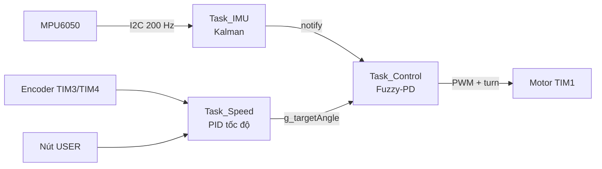
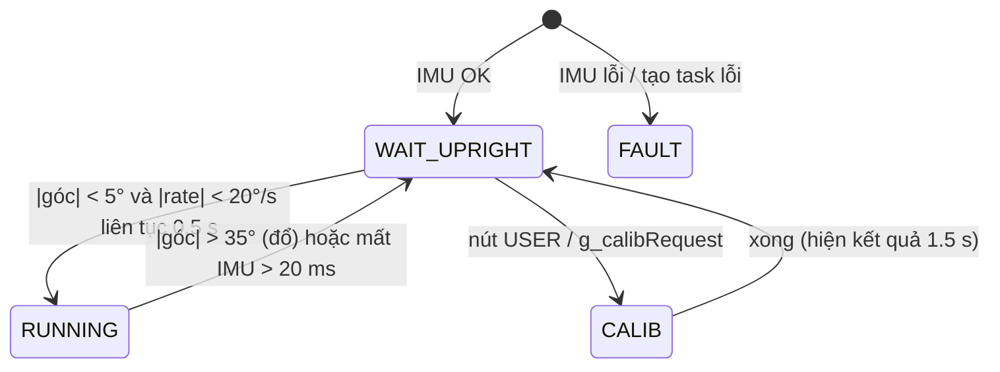

# Xe tự cân bằng 2 bánh — STM32F407 + FreeRTOS

Robot 2 bánh tự cân bằng dùng **STM32F407VG Discovery**, **MPU6050**, 2 động cơ DC có encoder.
Điều khiển tầng: **vòng góc Fuzzy-PD (200 Hz)** bên trong, **vòng tốc độ PID gia số (100 Hz)** bên ngoài,
góc nghiêng ước lượng bằng **bộ lọc Kalman**.

- [1. Phần cứng & sơ đồ chân](#1-phần-cứng--sơ-đồ-chân)
- [2. Cấu trúc mã nguồn](#2-cấu-trúc-mã-nguồn)
- [3. Cách hệ thống hoạt động](#3-cách-hệ-thống-hoạt-động)
- [4. Build & nạp](#4-build--nạp)
- [5. Quy trình chạy lần đầu (bring-up)](#5-quy-trình-chạy-lần-đầu-bring-up)
- [6. Test từng module rời rạc](#6-test-từng-module-rời-rạc)
- [7. Hiệu chuẩn IMU](#7-hiệu-chuẩn-imu)
- [8. Tinh chỉnh tham số](#8-tinh-chỉnh-tham-số)
- [9. Debug & tra cứu lỗi](#9-debug--tra-cứu-lỗi)

---

## 1. Phần cứng & sơ đồ chân

| Khối | Ngoại vi | Chân | Ghi chú |
|---|---|---|---|
| MPU6050 | I2C1, 400 kHz | PB8 = SCL, PB9 = SDA | Địa chỉ 0x68, cần pull-up |
| Motor trái | TIM1_CH1 (PWM 21 kHz) | PA8 | Chiều: PC8 (IN1), PC6 (IN2) |
| Motor phải | TIM1_CH2 (PWM 21 kHz) | PE11 | Chiều: PC9 (IN1), PC7 (IN2) |
| Encoder trái | TIM3 encoder x4 | PB4 = CH1, PB5 = CH2 | 330 xung/vòng trục ra → 1320 count/vòng |
| Encoder phải | TIM4 encoder x4 | PB6 = CH1, PB7 = CH2 | |
| LED | GPIO | PD12 xanh lá, PD13 cam, PD14 đỏ, PD15 xanh dương | |
| Nút USER | GPIO, pull-down | PA0 | Dùng cho hiệu chuẩn |
| Phím chức năng | EXTI0..3, pull-up nội, cạnh xuống | PC0 Calib, PC1 Set zero, PC2 Set target, PC3 dự phòng | Nối PCx ── nút ── GND (xem §7.1) |

> Không dùng PA9 cho PWM vì trên board Discovery PA9 nối VBUS USB OTG.

---

## 2. Cấu trúc mã nguồn

```
MDK_ARM/
  main.c              Khởi tạo, chọn chế độ chạy (APP_MOTOR_TEST), start scheduler
  template.uvprojx    Project Keil (IROM1 = 0xE0000 để chừa sector 11 cho dữ liệu hiệu chuẩn)
FreeRTOS/             Kernel + FreeRTOSConfig.h
MY_LIB/
  driver_i2c.c/.h     I2C1 + MPU6050: đọc burst 14 byte, timeout DWT, tự phục hồi bus, offset gyro, calib accel
  encoder.c/.h        TIM3/TIM4 encoder, tốc độ RPM có lọc LPF, vị trí tích lũy
  motor.c/.h          PWM TIM1, chiều quay, bù vùng chết liên tục, Enable/Brake
  kalman.c/.h         Kalman 2 trạng thái (góc, bias gyro)
  fuzzy.c/.h          Bộ điều khiển Fuzzy-PD 7x7 luật, chuẩn hóa ke/kde/ku
  pid.c/.h            PID dạng gia số (incremental), có Reset
  imu_calib.c/.h      Hiệu chuẩn IMU (LEVEL / ACCEL6 / ERASE) + lưu Flash có CRC
  gpio.c/.h           LED + nút USER (chống dội, phân biệt nhấn ngắn / giữ lâu)
  managetask.c/.h     3 task RTOS, máy trạng thái, an toàn, LED trạng thái
```

---

## 3. Cách hệ thống hoạt động

### 3.1 Trình tự khởi động

1. `main()` → `GPIO_Config()`, `Motor_Config()` (motor **tắt cứng** qua MOE của TIM1).
2. `Fuzzy_Init()`.
3. `System_Tasks_Init()`:
   - `I2C1_MPU6050_Init()`: kiểm WHO_AM_I, ghi cấu hình rồi đọc lại để xác nhận.
   - `ImuCalib_Init()`: nạp hiệu chuẩn từ Flash (offset/scale accel, góc cân bằng, bias gyro dự phòng).
   - `MPU6050_CalibrateGyro(200)`: đo bias gyro ~1 s → **giữ xe đứng yên khi cấp điện**.
     Thử tối đa 3 lần; nếu đều thất bại thì dùng bias trong Flash.
   - `Encoder_Config()`, `Kalman_Init()`, `PID_Init()` vòng tốc độ.
   - Tạo 3 task.
4. `vTaskStartScheduler()`.

### 3.2 Các task

| Task | Ưu tiên | Chu kỳ | Nhiệm vụ |
|---|---|---|---|
| `Task_IMU` | 4 (cao nhất) | 5 ms (200 Hz) | Đọc MPU6050 → tính pitch từ accel → Kalman → cấp mẫu cho hiệu chuẩn → **đánh thức** Task_Control |
| `Task_Control` | 3 | theo mẫu IMU | Máy trạng thái, Fuzzy-PD → PWM, LED |
| `Task_Speed` | 2 | 10 ms (100 Hz) | Đọc encoder → PID tốc độ → góc đặt; đọc nút USER |



### 3.3 Vòng điều khiển tầng

```
g_targetSpeed ──►(PID tốc độ)──► speedOut (±6°) ──► g_targetAngle = g_angleOffset + speedOut
                       ▲                                       │
                  g_motorSpeed                                 ▼
                 (encoder, RPM)        e = pitch − g_targetAngle, de = rate
                                                  │
                                           (Fuzzy-PD) ──► PWM % ──► Motor_SetPWM_Diff(pwm, g_turn)
```

- **Vòng góc:** xe nghiêng tới (e > 0) → PWM > 0 → bánh chạy tới đỡ trọng tâm.
- **Vòng tốc độ:** xe chạy tới nhanh hơn đặt → góc đặt âm (ngả ra sau) → xe chậm lại.
- Fuzzy mặc định tương đương **Kp = 10 %PWM/deg, Kd = 0.5 %PWM/(deg/s)**, bão hòa ±100 %.
- Bù vùng chết motor nằm trong driver (`MOTOR_x_DEADZONE`), ánh xạ liên tục, không nhảy bậc.

### 3.4 Quy ước dấu (bắt buộc đúng trước khi cho xe tự cân bằng)

| Đại lượng | Dương khi | Sửa ở đâu nếu sai |
|---|---|---|
| Pitch (`g_rawAccPitch`, `g_filteredPitch`) | Xe nghiêng **về phía trước** | `IMU_PITCH_SIGN` (managetask.c) |
| Rate (`g_rawGyroRate`) | Cùng dấu với pitch khi đang nghiêng tới | `IMU_GYRO_SIGN` (managetask.c) |
| PWM | Bánh quay **tiến** | `MOTOR_LEFT/RIGHT_INVERT` (motor.h) |
| Speed (`g_motorSpeed`) | Xe chạy **tiến** | `ENCODER_LEFT/RIGHT_INVERT` (encoder.h) |

Khi 4 quy ước trên đúng, mọi dấu trong vòng điều khiển tự đúng. `BAL_OUTPUT_SIGN` chỉ đảo khi đã kiểm hết mà vẫn ngược.

### 3.5 Máy trạng thái an toàn



| Trạng thái | Motor | LED |
|---|---|---|
| `BAL_WAIT_UPRIGHT` | Tắt cứng | Cam |
| `BAL_RUNNING` | Chạy | Xanh lá |
| `BAL_CALIB` | Tắt cứng | Cam nháy 4 Hz (đang đo), xanh lá chớp khi thu 1 mặt |
| `BAL_FAULT` | Tắt cứng, không tự thoát | Đỏ |
| Stack overflow / hết heap | Tắt, CPU dừng hẳn | Đỏ, các LED khác tắt |

LED xanh dương nháy ~1 Hz = Task_IMU đang đọc cảm biến thành công. **Xanh dương đứng yên = IMU không có dữ liệu.**

---

## 4. Build & nạp

- Keil MDK 5, project `MDK_ARM/template.uvprojx`, **ARM Compiler 5 (ARMCC)** — port FreeRTOS là `RVDS/ARM_CM4F`.
  Nếu Keil báo thiếu compiler V5: cài ARMCC 5 hoặc chuyển sang AC6 kèm port `GCC/ARM_CM4F`.
- Define: `STM32F40_41xxx`, `USE_STDPERIPH_DRIVER`, `HSE_VALUE=8000000`; bật C99.
- **Không** đặt lại IROM1 về 0x100000: sector 11 (0x080E0000–0x080FFFFF) dành cho dữ liệu hiệu chuẩn.
- Kiểm tra cú pháp nhanh không cần Keil (từ thư mục gốc, cần header FreeRTOS giả cho file dùng RTOS):

```powershell
arm-none-eabi-gcc -mcpu=cortex-m4 -mthumb -mfpu=fpv4-sp-d16 -mfloat-abi=hard -std=c99 -Wall -Wextra `
  -DSTM32F40_41xxx -DUSE_STDPERIPH_DRIVER -DHSE_VALUE=8000000 -fsyntax-only `
  -IMDK_ARM -ILibraries\CMSIS\Device\ST\STM32F4xx\Include -ILibraries\STM32F4xx_StdPeriph_Driver\inc `
  -ILibraries\CMSIS\Include -IMY_LIB -I. MY_LIB\motor.c
```

---

## 5. Quy trình chạy lần đầu (bring-up)

Làm **đúng thứ tự**, bước sau dựa trên kết quả bước trước. Kê xe lên cho bánh quay tự do ở các bước 2–4.

| Bước | Việc | Đạt khi |
|---|---|---|
| 1 | Test IMU (§6.2) | `g_imuStatus = 0`, LED xanh dương nháy, pitch đúng dấu |
| 2 | Test motor (§6.1) | Cả 2 bánh quay **tiến** với PWM +20 % |
| 3 | Test encoder (§6.3) | Đẩy xe tới → `g_motorSpeed > 0`, 1 vòng bánh ≈ 1320 count |
| 4 | Test vòng góc khi treo xe | Nghiêng xe tới → bánh quay tới; nghiêng lùi → bánh quay lùi |
| 5 | Hiệu chuẩn ACCEL6 (1 lần) rồi LEVEL (§7) | LED xanh lá + cam sáng sau mỗi lần |
| 6 | Thả xe, tay giữ hờ | Xe đứng được; chỉnh Kp/Kd (§8) |
| 7 | Bật vòng tốc độ | Xe không trôi; chỉnh `SPEED_KP/KI` |

> Ở bước 4–6, muốn chỉ thử vòng góc thì tạm đặt `SPEED_KP` và `SPEED_KI` = 0.

---

## 6. Test từng module rời rạc

Nguyên tắc: test **không cần RTOS** trước (ít biến số), quan sát bằng **Watch window** của Keil
(Debug → View → Watch, bật *View → Periodic Window Update* để giá trị cập nhật khi đang chạy).

### 6.1 Motor + PWM — có sẵn

Trong [main.c](MDK_ARM/main.c):

```c
#define APP_MOTOR_TEST   1       /* 1 = test motor, 0 = chạy cân bằng */
#define APP_TEST_PWM     20.0f   /* % PWM, âm = lùi */
```

Kiểm tra:
- Cả 2 bánh quay **tiến**. Sai bánh nào → đổi `MOTOR_LEFT_INVERT` / `MOTOR_RIGHT_INVERT` trong `motor.h`.
- Tìm vùng chết: giảm dần `APP_TEST_PWM` tới khi bánh vừa dừng; nếu bánh đứng yên ở 3–5 % thì tăng
  `MOTOR_x_DEADZONE`, nếu đã giật mạnh ở 1 % thì giảm.
- Đo bằng oscilloscope: PA8 / PE11 là PWM 21 kHz, duty = deadzone + lệnh.
- Khi dừng tại breakpoint, PWM bị đóng băng (TIM1 dừng theo debug) → an toàn khi debug.

### 6.2 IMU (MPU6050) — bare-metal

Thêm tạm một chế độ test vào `main.c` (đặt `APP_MOTOR_TEST 0`, thay khối `#else` bằng đoạn dưới), hoặc
copy vào một hàm riêng:

```c
volatile uint8_t  t_err;
volatile float    t_pitch, t_rate, t_ax, t_ay, t_az;
volatile uint32_t t_errCnt;

GPIO_Config();
Motor_Config();                         /* motor vẫn tắt */
t_err = I2C1_MPU6050_Init();            /* 0 = OK, xem bảng mã lỗi §9.2 */
if (t_err == 0u) t_err = MPU6050_CalibrateGyro(200u);   /* giữ yên ~1 s */
while (1) {
    MPU6050_Data_t d;
    if (MPU6050_Read(&d) == 0u) {
        t_ax = d.ax; t_ay = d.ay; t_az = d.az;          /* [g]     */
        t_pitch = MPU6050_AccelPitch(&d);               /* [deg]   */
        t_rate  = d.gy;                                 /* [deg/s] */
    }
    t_errCnt = MPU6050_GetErrorCount();
    DWT_DelayMs(5u);
}
```

Kiểm tra:
- Đặt nằm ngang: `|t_ax|, |t_ay| ≈ 0`, `t_az ≈ +1 g` (hoặc −1 g tùy mặt). Độ lớn vector ≈ 1.00 g.
- Nghiêng **tới từ từ**: `t_pitch` tăng dương và `t_rate` dương trong lúc nghiêng. Sai → đổi
  `IMU_PITCH_SIGN` / `IMU_GYRO_SIGN`. Nếu pitch không đổi mà roll đổi → cảm biến gắn xoay 90°, dùng
  `MPU6050_AccelRoll()` + `gx`.
- Đứng yên: `t_rate` dao động < ±0.5 deg/s; `t_errCnt` không tăng.
- Rút dây SDA khi đang chạy rồi cắm lại → `t_errCnt` tăng, sau đó đọc tiếp được (bus tự phục hồi).

### 6.3 Encoder — bare-metal

```c
volatile int32_t t_posL, t_posR;
volatile float   t_spdL, t_spdR;

Encoder_Config();
Encoder_t L, R;
Encoder_Reset(&L, &R);
while (1) {
    DWT_DelayMs(10u);
    Encoder_Update(&L, &R, 0.010f);
    t_posL = L.position;  t_posR = R.position;
    t_spdL = L.speed;     t_spdR = R.speed;      /* RPM đã lọc */
}
```

> Gọi `DWT_DelayInit()` trước nếu không gọi `I2C1_MPU6050_Init()`.

Kiểm tra:
- Quay tay bánh **đúng 1 vòng tiến** → `position` tăng ≈ +1320. Sai dấu → `ENCODER_x_INVERT`.
  Sai độ lớn → sửa `ENCODER_PULSES_PER_REV` theo datasheet motor (PPR × tỉ số hộp số).
- Kết hợp §6.1 (PWM 20 %): 2 bánh cho RPM gần bằng nhau và **dương**.
- Số nhảy lung tung khi motor chạy → nhiễu: tăng `ENCODER_INPUT_FILTER`, dùng dây xoắn/chống nhiễu.

### 6.4 Kalman — trên chip

Chạy hệ đầy đủ (`APP_MOTOR_TEST 0`), xe **ở trạng thái chờ** (đặt nghiêng > 5° để motor không bật), so sánh
`g_rawAccPitch` và `g_filteredPitch` trên Logic Analyzer của Keil:
- Lắc nhẹ xe: `g_rawAccPitch` nhiễu mạnh, `g_filteredPitch` mượt nhưng bám kịp.
- Đứng yên lâu: `g_filteredPitch` không trôi.
- Bám chậm → tăng `Q_angle` hoặc giảm `R_measure` (kalman.c). Quá nhiễu → làm ngược lại.

### 6.5 Fuzzy / PID — trên máy tính (không cần board)

`fuzzy.c` và `pid.c` chỉ dùng C chuẩn + `math.h`, biên dịch được bằng gcc trên PC. Ví dụ `test_fuzzy.c`:

```c
#include <stdio.h>
#include "fuzzy.h"
int main(void) {
    FuzzyController_t fc;
    Fuzzy_Init(&fc);
    for (float e = -15.0f; e <= 15.0f; e += 2.5f)
        printf("e=%6.1f  u(de=0)=%7.2f  u(de=+50)=%7.2f\n",
               e, Fuzzy_Compute(&fc, e, 0.0f), Fuzzy_Compute(&fc, e, 50.0f));
    return 0;
}
```

```powershell
gcc -std=c99 -IMY_LIB test_fuzzy.c MY_LIB\fuzzy.c -lm -o test_fuzzy.exe; .\test_fuzzy.exe
```

Kết quả thực tế (đã chạy):

```
e=   0.0  u(de=0)=   0.00  u(de=+50)=  25.00
e=   2.5  u(de=0)=  25.00  u(de=+50)=  50.00
e=   5.0  u(de=0)=  50.00  u(de=+50)=  75.00
e=  10.0  u(de=0)= 100.00  u(de=+50)= 100.00
```

Kỳ vọng:
- `u(0,0) = 0`, `u(−e, −de) = −u(e, de)` (đối xứng lẻ).
- Quanh 0: `u ≈ 10·e + 0.5·de` (Kp_eq, Kd_eq mặc định); `u` đơn điệu tăng theo e và de.
- Bão hòa ±100 khi |e| ≥ 10° hoặc |de| ≥ 200°/s.

PID tương tự: gọi `PID_Compute()` với sai lệch hằng → đầu ra tăng tuyến tính (khâu I) và dừng ở giới hạn ±6.

### 6.6 Nút USER + LED

Chạy hệ đầy đủ, xe nằm (không chạy motor): nhấn ngắn → `g_calibRequest` thoáng = 1 rồi về 0, LED cam nháy
(đang LEVEL). Giữ 2 s → ACCEL6. Nhấn khi xe đang `RUNNING` sẽ bị bỏ qua (thiết kế an toàn).

---

## 7. Hiệu chuẩn IMU

Chỉ được nhận khi motor đang tắt (`BAL_WAIT_UPRIGHT`, LED cam). Dữ liệu lưu ở Flash sector 11, có CRC32.

| Lệnh | Cách gọi | Làm gì | Thời gian |
|---|---|---|---|
| **LEVEL** | Nhấn ngắn nút USER, hoặc Watch: `g_calibRequest = 1` | Giữ xe **đúng điểm cân bằng**, đứng yên → lưu góc cân bằng + bias gyro | ~3 s (tối đa 15 s) |
| **ACCEL6** | Giữ nút ≥ 2 s, hoặc `g_calibRequest = 2` | Lần lượt đặt 6 mặt hướng lên (thứ tự bất kỳ), mỗi mặt yên ~1.5 s; LED xanh lá chớp = đã nhận mặt | tối đa 120 s |
| **ERASE** | `g_calibRequest = 3` | Xóa hiệu chuẩn, về mặc định | ~1–2 s |

- **Thứ tự:** ACCEL6 một lần (khi lắp lại cảm biến) → rồi LEVEL. ACCEL6 xóa góc cân bằng cũ.
- Kết quả hiển thị 1.5 s: **xanh lá + cam sáng = OK**, **đỏ nháy = lỗi** (xem `g_calibError`).
- Ghi Flash làm CPU đứng ~1–2 s — bình thường, motor đang tắt.
- Sau LEVEL, xe đang đứng thẳng và yên 0.5 s sẽ **tự bật cân bằng** → giữ tay sẵn.
- `g_calibFaces`: bitmask mặt đã thu (bit0 +X, bit1 −X, … bit5 −Z; `0x3F` = đủ).
- `g_calibFlags`: bit0 có gyro, bit1 có accel, bit2 có góc cân bằng.

### 7.1 Phím ngắt ngoài PC0..PC3

| Phím | Nhấn ngắn | Giữ ≥ 2 s | Điều kiện |
|---|---|---|---|
| **PC0 – Calib** | ACCEL6 (6 mặt) | ERASE (xóa hiệu chuẩn) | Motor tắt (LED cam) |
| **PC1 – Set zero** | Reset vị trí encoder, `g_targetSpeed = 0`, `g_turn = 0` (luôn làm) **+** đo bias gyro 2 s, lưu Flash (chỉ khi motor tắt) | — | Xe **nằm yên**, tư thế bất kỳ |
| **PC2 – Set target** | Lấy góc hiện tại làm góc cân bằng | — | Xem 2 trường hợp dưới |
| **PC3 – dự phòng** | `g_keySpareShort++` | `g_keySpareLong++` | Thêm chức năng ở cuối `vTaskSpeed` |

Set target (PC2):
- **Xe đang tự cân bằng (LED xanh lá):** motor **vẫn chạy**, lấy trung bình pitch 2 s (xanh lá + cam nháy) →
  đổi góc cân bằng **không giật** (bù vào `speedPID.pre_Output`). Kết quả 1 s: xanh lá + cam = OK, xanh lá + đỏ = lỗi.
  Chỉ lưu RAM; **tự ghi Flash khi xe nằm xuống** (|góc| > 35°) vì ghi Flash làm CPU đứng 1–2 s.
- **Motor đang tắt (LED cam):** giữ xe bằng tay ở điểm cân bằng, nhấn → quy trình như LEVEL nhưng chỉ lưu góc
  (cho phép rung tay tới 15 °/s).

Cơ chế: ISR (ưu tiên 10, không gọi API FreeRTOS) chỉ ghi nhận cạnh xuống và **khóa đường EXTI** đó;
`Keys_Poll()` chạy mỗi 10 ms trong `Task_Speed` xác nhận phím còn giữ ≥ 30 ms, đo thời gian giữ, chờ nhả ≥ 50 ms
rồi mới mở lại ngắt ⇒ dội phím không gây bão ngắt. `Keys_GetIrqCount(k)` đếm số ngắt (kể cả dội) để debug.

> Phần cứng Discovery: **PC0** nối chân EN của chip nguồn USB OTG (STMPS2141) — nhấn PC0 sẽ bật 5 V ra cổng
> micro-USB OTG, vô hại nếu không cắm gì. **PC3** nối ngõ ra PDM của micro MP45DT02 — chưa kiểm chứng micro
> có giữ chân này khi không cấp clock hay không, nên để PC3 làm phím dự phòng. Nếu thấy PC3 không xuống mức 0 khi nhấn
> (xem `Keys_GetIrqCount(KEY_SPARE)`), đổi sang chân khác.

---

## 8. Tinh chỉnh tham số

| Tham số | File | Mặc định | Ý nghĩa |
|---|---|---|---|
| `Fuzzy_SetFromPD(&fuzzyControl, Kp, Kd)` | gọi sau `Fuzzy_Init` | Kp 10, Kd 0.5 | Cách dễ nhất để chỉnh vòng góc theo kiểu PD |
| `ke`, `kde`, `ku` | fuzzy.c | 0.1, 0.005, 100 | Chuẩn hóa vào/ra trực tiếp |
| `SPEED_KP / KI` | managetask.c | 0.05 / 0.02 | Vòng tốc độ (RPM → deg) |
| `SPEED_ANGLE_LIMIT` | managetask.c | 6° | Góc đặt tối đa do vòng tốc độ tạo ra |
| `BAL_FALL_ANGLE` | managetask.c | 35° | Ngưỡng coi là đổ |
| `MOTOR_x_DEADZONE` | motor.h | 15 % | Bù vùng chết |
| `Q_angle, Q_bias, R_measure` | kalman.c | 0.001, 0.003, 0.03 | Độ tin gyro vs accel |
| `MPU6050_DLPF_CFG` | driver_i2c.h | 0x03 (44 Hz) | Lọc số trong cảm biến; 0x02 ít trễ hơn |

Trình tự chỉnh vòng góc (tắt vòng tốc độ):
1. Kd = 0, tăng Kp tới khi xe dao động quanh điểm cân bằng.
2. Tăng Kd tới khi hết dao động; nếu bánh rung/kêu rè → Kd quá lớn hoặc gyro nhiễu.
3. Bật lại vòng tốc độ với Kp nhỏ, tăng dần tới khi xe hết trôi; thêm Ki vừa đủ.

---

## 9. Debug & tra cứu lỗi

### 9.1 Biến theo dõi (Watch / Logic Analyzer)

| Biến | Ý nghĩa |
|---|---|
| `g_balanceState` | 0 WAIT_UPRIGHT, 1 RUNNING, 2 FAULT, 3 CALIB |
| `g_imuStatus` | Mã lỗi khởi tạo IMU (0 = OK) |
| `g_imuCalibStatus` | Kết quả đo bias gyro lúc khởi động (9 = xe rung) |
| `g_rawAccPitch`, `g_rawGyroRate` | Pitch từ accel, rate từ gyro (đã áp dấu) |
| `g_filteredPitch`, `g_filteredRate` | Sau Kalman — giá trị dùng cho điều khiển |
| `g_targetAngle`, `g_angleOffset` | Góc đặt hiện tại, góc cân bằng đang dùng |
| `g_motorPWM` | Lệnh Fuzzy [%] |
| `g_motorSpeed`, `g_wheelPosition` | Tốc độ trung bình [RPM], vị trí [count] |
| `g_fallCount`, `g_imuTimeoutCount` | Số lần đổ, số lần mất mẫu IMU |
| `g_targetSpeed`, `g_turn` | Ghi tay để thử chạy tới / rẽ |
| `g_calibStatus/Error/Faces/Flags` | Hiệu chuẩn (§7) |

> Kiểm tra mẫu IMU: thêm `MPU6050_GetErrorCount()` / `MPU6050_GetRecoverCount()` vào Watch —
> tăng liên tục nghĩa là đường I2C có vấn đề.

### 9.2 Mã lỗi IMU (`g_imuStatus`, `g_imuCalibStatus`)

| Mã | Tên | Nguyên nhân thường gặp |
|---|---|---|
| 0 | `I2C_OK` | — |
| 1 | `I2C_ERR_BUSY` | SDA bị giữ thấp: thiếu pull-up, cảm biến treo, chập dây |
| 2 | `I2C_ERR_START` | Không tạo được START — lỗi bus/nhiễu |
| 3 | `I2C_ERR_ADDR` | Không ACK địa chỉ: sai dây, chân AD0 = 1 (địa chỉ 0x69), mất nguồn |
| 4 / 5 | `I2C_ERR_TX / RX` | Mất kết nối giữa chừng, dây quá dài, nhiễu motor |
| 6 | `I2C_ERR_PARAM` | Lỗi lập trình (tham số sai) |
| 7 | `MPU_ERR_WHOAMI` | Có thiết bị trả lời nhưng không phải MPU6050 (hoặc module clone ID khác) |
| 8 | `MPU_ERR_CONFIG` | Ghi cấu hình rồi đọc lại không khớp |
| 9 | `MPU_ERR_MOVING` | Xe rung khi đo bias gyro |

Mã lỗi hiệu chuẩn (`g_calibError`): 1 hết giờ (không đứng yên / chưa đủ 6 mặt), 2 kết quả vô lý
(đặt sai tư thế, cảm biến hỏng), 3 ghi Flash lỗi.

### 9.3 Bảng triệu chứng

| Triệu chứng | Kiểm tra | Cách xử lý |
|---|---|---|
| LED đỏ ngay khi bật | `g_imuStatus` | Tra §9.2; kiểm dây PB8/PB9, nguồn 3.3 V, pull-up |
| LED đỏ, các LED khác tắt hẳn, CPU không chạy | Breakpoint `vApplicationStackOverflowHook`, xem `pcTaskName` | Tăng stack task đó (256 word) hoặc tăng `configTOTAL_HEAP_SIZE` |
| LED cam mãi, không vào RUNNING | `g_filteredPitch − g_angleOffset`, `g_filteredRate` | Phải < 5° và < 20°/s liên tục 0.5 s; chạy LEVEL nếu góc cân bằng sai |
| LED xanh dương không nháy | `MPU6050_GetErrorCount()` | IMU mất kết nối khi chạy; thường do nhiễu motor → dây ngắn, tụ lọc nguồn |
| Vừa bật RUNNING xe lao một phía và đổ ngay | Dấu (§3.4) | Treo xe, nghiêng tới: bánh phải quay tới. Ngược → sửa dấu IMU/motor, **không** sửa bằng `BAL_OUTPUT_SIGN` trước |
| Xe dao động ngày càng lớn | Kp quá lớn / Kd thiếu | Giảm Kp, tăng Kd |
| Bánh rung rè, phát nóng, dao động nhanh | Kd quá lớn, gyro nhiễu, deadzone quá lớn | Giảm Kd; DLPF 0x03; giảm `MOTOR_x_DEADZONE` |
| Xe đứng được nhưng trôi dần một phía | Góc cân bằng sai / vòng tốc độ yếu | Chạy LEVEL; tăng `SPEED_KP/KI`; kiểm dấu encoder |
| Xe chạy được vài giây rồi đổ theo chu kỳ chậm | Vòng tốc độ quá mạnh hoặc dấu encoder sai | Giảm `SPEED_KP`; đẩy xe tới phải thấy `g_motorSpeed > 0` |
| Một bánh yếu hơn, xe xoay tròn | So `t_spdL/t_spdR` ở PWM bằng nhau | Chỉnh deadzone riêng từng bánh; kiểm driver motor |
| `g_imuTimeoutCount` tăng khi motor chạy | Sụt áp / nhiễu EMI | Nguồn riêng cho logic, tụ 100 µF + 100 nF gần driver, dây motor xoắn |
| Hiệu chuẩn báo đỏ (lỗi 2) | `g_calibFaces` | Mỗi mặt phải thẳng đứng thật (dùng mép bàn), không cầm tay rung |
| Mất hiệu chuẩn sau khi nạp code | Keil xóa toàn chip | Trong *Flash Download* chọn **Erase Sectors** thay vì *Erase Full Chip* |
| Treo ở HardFault | Keil: *Peripherals → Core Peripherals → Fault Reports*, xem PC trong stack | Thường do con trỏ NULL / tràn stack |

### 9.4 Mẹo debug với Keil

- **Logic Analyzer** (*View → Analysis Windows*): thêm `g_filteredPitch`, `g_motorPWM`, `g_motorSpeed` để
  xem đáp ứng theo thời gian — cách nhanh nhất để chỉnh Kp/Kd.
- Dừng tại breakpoint không làm motor chạy loạn (PWM đóng băng), nhưng **RTOS mất nhịp**: sau khi Run tiếp
  sẽ có 1 lần IMU timeout → xe về WAIT_UPRIGHT. Đó là hành vi đúng.
- Ghi biến trong Watch khi đang chạy (ví dụ `g_targetSpeed = 30`, `g_turn = 10`) để thử điều khiển mà
  không cần nạp lại.
- Muốn thử nhanh tham số Fuzzy: ghi trực tiếp `fuzzyControl.ke / kde / ku` trong Watch.
