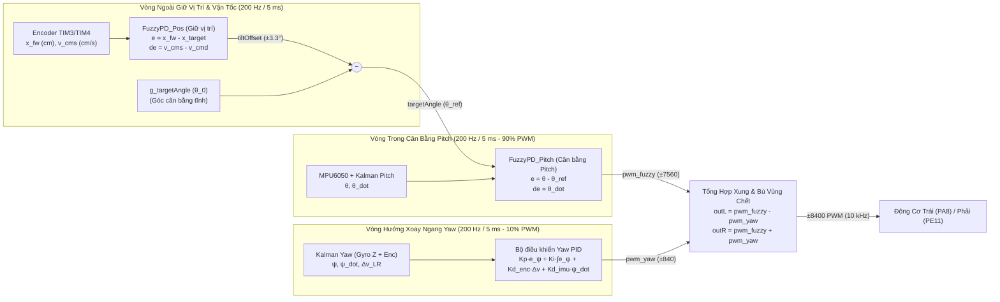

# Hệ Thống Robot Hai Bánh Tự Cân Bằng (TWIP) — STM32F407VG & FreeRTOS

[-03234B?logo=stmicroelectronics)](https://www.st.com/en/microcontrollers-microprocessors/stm32f407vg.html)
[](https://www.freertos.org/)
[](#3-kiến-trúc-điều-khiển-vòng-lồng-cascaded-dual-fuzzypd)
[-B71C1C)](./luu_do_dieu_khien_fuzzy.pdf)

Dự án thiết kế và triển khai hệ thống điều khiển **Robot hai bánh tự cân bằng (Two-Wheeled Inverted Pendulum — TWIP)** thời gian thực trên vi điều khiển **STM32F407VGT6** (ARM Cortex-M4F @ 168 MHz) sử dụng hệ điều hành thời gian thực **FreeRTOS**.

Hệ thống kết hợp **Bộ lọc Kalman** đa kênh (Pitch IMU, Yaw hợp nhất Encoder + Gyro Z, và vận tốc 2 bánh xe) cùng **Kiến trúc Điều khiển Mờ Vòng Lồng Kép (Cascaded Dual-FuzzyPD Control)** gồm Vòng ngoài giữ vị trí – vận tốc (`FuzzyPD_Pos`, 50 Hz) và Vòng trong cân bằng góc chúc ngóc (`FuzzyPD_Pitch`, 200 Hz, 90% PWM) phối hợp với bộ điều khiển hướng xoay ngang (`Yaw PID`, 200 Hz, 10% PWM).

📄 **Tài liệu bài báo kỹ thuật & lưu đồ thuật toán:** [`luu_do_dieu_khien_fuzzy.pdf`](./luu_do_dieu_khien_fuzzy.pdf) (Mã nguồn LaTeX: [`luu_do_dieu_khien_fuzzy.tex`](./luu_do_dieu_khien_fuzzy.tex))

---

## Mục Lục

1. [Kiến Trúc Phần Cứng & Sơ Đồ Chân (Pinout)](#1-kiến-trúc-phần-cứng--sơ-đồ-chân-pinout)
2. [Cấu Trúc Thư Mục Mã Nguồn](#2-cấu-trúc-thư-mục-mã-nguồn)
3. [Kiến Trúc Điều Khiển Vòng Lồng (Cascaded Dual-FuzzyPD)](#3-kiến-trúc-điều-khiển-vòng-lồng-cascaded-dual-fuzzypd)
4. [Thiết Kế Bộ Điều Khiển Mờ 5 Khâu (`fuzzy.c`)](#4-thiết-kế-bộ-điều-khiển-mờ-5-khâu-fuzzyc)
5. [Đa Nhiệm Thời Gian Thực (FreeRTOS Tasks) & Lọc Kalman](#5-đa-nhiệm-thời-gian-thực-freertos-tasks--lọc-kalman)
6. [Giao Thức Truyền Thông UART/DMA & Phần Mềm Giám Sát GUI](#6-giao-thức-truyền-thông-uartdma--phần-mềm-giám-sát-gui)
7. [Hướng Dẫn Biên Dịch, Nạp Firmware & Hiệu Chuẩn](#7-hướng-dẫn-biên-dịch-nạp-firmware--hiệu-chuẩn)

---

## 1. Kiến Trúc Phần Cứng & Sơ Đồ Chân (Pinout)

### Thông số cơ khí & cảm biến
- **Vi điều khiển:** STM32F407VGT6 (168 MHz, tích hợp FPU phần cứng đơn chính xác, 32 KB FreeRTOS Heap).
- **Cảm biến quán tính (IMU):** MPU6050 giao tiếp `I2C1` (400 kHz Fast-Mode), tần số trích mẫu nội 200 Hz (`SMPLRT_DIV = 0x04`), bộ lọc thông thấp số `DLPF = 0x03` (~44 Hz), thang đo Gyroscope $\pm 500^\circ/\text{s}$ ($65.5\;\text{LSB}/(^\circ/\text{s})$), Accelerometer $\pm 2g$ ($16384\;\text{LSB}/g$).
- **Động cơ & Encoder:** 2 động cơ DC giảm tốc JGB37-520 có Encoder cầu phương 2 kênh A/B (`330 PPR` $\times 4 = 1320\text{ xung/vòng}$ ở chế độ `TIM_EncoderMode_TI12`, tích hợp lọc số phần cứng `IC1F = IC2F = 0x0F`).
- **Kích thước hình học:** Đường kính bánh xe $D = 65\text{ mm} = 6.5\text{ cm}$ (chu vi $C = \pi D = 20.420352\text{ cm}$, hệ số quy đổi $0.01547\text{ cm/xung}$), khoảng cách hai bánh (Wheelbase) $W = 19.21\text{ cm}$, vận tốc đặt tối đa `ROBOT_MAX_SPEED_CMS = 10.0 cm/s` ($\approx 29.38\text{ RPM}$).

### Bảng phân bổ ngoại vi và chân GPIO

| Khối Chức Năng | Ngoại Vi STM32 | Chân GPIO | Mô Tả Chi Tiết |
| :--- | :--- | :--- | :--- |
| **IMU MPU6050** | `I2C1` (400 kHz) | `PB8` (SCL), `PB9` (SDA) | Đọc 6 trục Accel/Gyro ($\pm 2g$, $\pm 500^\circ/\text{s}$), tích hợp chống treo bus (`I2C1_Recover`) |
| **PWM Động Cơ Trái** | `TIM1_CH1` (10 kHz) | `PA8` (PWM), `PC8` / `PC6` (DIR) | Độ phân giải 8400 mức (`ARR = 8399, PSC = 1` trên APB2 168 MHz), điều khiển cầu H |
| **PWM Động Cơ Phải** | `TIM1_CH2` (10 kHz) | `PE11` (PWM), `PC9` / `PC7` (DIR) | Độ phân giải 8400 mức ($\approx 0.012\%/\text{bước}$), `PC9/PC7` điều khiển chiều quay |
| **Encoder Bánh Trái** | `TIM3` (Encoder x4) | `PB4` (CH1), `PB5` (CH2) | Đếm xung phần cứng 16-bit hai cạnh lên/xuống (`1320 counts/rev`), lọc gai $>45\text{ xung}/5\text{ms}$ |
| **Encoder Bánh Phải** | `TIM4` (Encoder x4) | `PB6` (CH1), `PB7` (CH2) | Đếm xung phần cứng 16-bit hai cạnh lên/xuống (`1320 counts/rev`), lọc gai $>45\text{ xung}/5\text{ms}$ |
| **Telemetry / Bluetooth** | `USART3` + `DMA1_S3` | `PD8` (TX), `PD9` (RX) | Baudrate `115200 bps`; TX dùng `DMA1_Stream3` (Ch 4), RX dùng ngắt `RXNE` + Ring Buffer 128B |
| **Nút Nhấn Ngoài** | `EXTI0` – `EXTI2` | `PC0` (Start), `PC1` (Stop), `PC2` (Calib) | Ngắt ngoài sườn xuống (`Pull-Up`); `PC2` đặt cờ `s_calibPending` để chạy Calib an toàn trong Task |
| **LED Trạng Thái** | `GPIOD` | `PD12` (Xanh), `PD13` (Cam), `PD14` (Đỏ), `PD15` (Lam) | Báo trạng thái RUNNING (`PD12`), CALIB Gyro/Encoder (`PD13`), STOP/Lỗi (`PD14`), UART/Flash (`PD15`) |
| **Lưu Cấu Hình** | `FLASH Sector 11` | `0x080E0000` (128 KB) | Lưu `magic = 0x55AA2026`, `targetAngle`, `gyroOffset` và mã kiểm tra toàn vẹn `XOR Checksum` |

---

## 2. Cấu Trúc Thư Mục Mã Nguồn

```text
balance-robot/
├── MDK_ARM/
│   ├── main.c                        # Điểm vào chương trình, khởi tạo FuzzyPD_Pitch & FuzzyPD_Pos, chạy FreeRTOS
│   └── template.uvprojx              # Project Keil MDK-ARM uVision 5
├── MY_LIB/
│   ├── fuzzy.c / fuzzy.h             # Bộ điều khiển Mờ PD 5 khâu tổng quát (FuzzyController_t, FuzzyPD_Compute)
│   ├── kalman.c / kalman.h           # Bộ lọc Kalman 2 trạng thái góc nghiêng (Pitch/Yaw) & vận tốc bánh xe
│   ├── pid.c / pid.h                 # Bộ điều khiển PID số dạng gia số (Incremental PID) cho chế độ Dual-PID
│   ├── managetask.c / managetask.h   # Quản lý 4 Task FreeRTOS, vòng điều khiển Cascade, Auto-Calib & giao thức UART
│   ├── driver_i2c.c / driver_i2c.h   # Driver I2C1 phần cứng (PB8/PB9), Bus Recovery & giao tiếp MPU6050
│   ├── driver_uart.c / driver_uart.h # Driver USART3 (PD8/PD9) kết hợp DMA1_Stream3 TX và Ring Buffer RX
│   ├── driver_flash.c / driver_flash.h # Lưu/đọc cấu hình hiệu chuẩn vào bộ nhớ Flash nội (Sector 11 - 0x080E0000)
│   ├── encoder.c / encoder.h         # Đọc xung Encoder TIM3 (PB4/PB5) & TIM4 (PB6/PB7), tính vận tốc & góc Yaw
│   ├── motor.c / motor.h             # Điều chế xung PWM TIM1 10 kHz (PA8/PE11, thang ±8400) và điều khiển chiều
│   └── gpio.c / gpio.h               # Cấu hình 4 LED chỉ thị (PD12..15) và ngắt ngoài EXTI0..2 (PC0..2)
├── FreeRTOS/                         # Nhân hệ điều hành thời gian thực FreeRTOS v11.1 (ARM Cortex-M4F port)
├── Libraries/                        # Thư viện CMSIS & STM32F4xx Standard Peripheral Driver
├── luu_do_dieu_khien_fuzzy.tex       # Mã nguồn LaTeX bài báo kỹ thuật hệ thống điều khiển
├── luu_do_dieu_khien_fuzzy.pdf       # Bản PDF bài báo kỹ thuật & phân tích thực nghiệm
└── README.md                         # Tài liệu hướng dẫn hệ thống
```

---

## 3. Kiến Trúc Điều Khiển Vòng Lồng (Cascaded Dual-FuzzyPD)

Hệ thống giải quyết bài toán điều khiển hệ **SIMO phi tuyến bất ổn định và không pha cực tiểu (non-minimum phase)** — nơi 1 cặp động cơ bánh xe phải đồng thời giữ cân bằng góc chúc ngóc $\theta$ và kiểm soát vị trí dài $x$ / vận tốc $v$ — thông qua cấu trúc **Điều khiển Mờ Vòng Lồng Kép (Cascaded Dual-FuzzyPD Control)**:



### Nguyên lý phối hợp 3 vòng điều khiển đồng bộ 200 Hz
1. **Vòng Ngoài — Giữ Vị Trí & Bám Vận Tốc (`FuzzyPD_Pos`, chu kỳ $T_s = 5\text{ ms} / 200\text{ Hz}$):**
   - Nhận sai số vị trí dài $e_x = x_{\text{fw}} - x_{\text{target}}\;(\text{cm})$ và sai số vận tốc dài $e_v = v_{\text{cms}} - v_{\text{cmd}}\;(\text{cm/s})$.
   - Điểm đích $x_{\text{target}}$ tự động dịch chuyển mượt theo vận tốc đặt $v_{\text{cmd}}$ và được kẹp chống bão hòa (anti-windup) trong phạm vi $\pm 15.0\text{ cm}$ (`POS_TARGET_LEAD_MAX_CM`) quanh vị trí hiện tại $x_{\text{fw}}$.
   - Tính toán trực tiếp góc nghiêng đặt bù trừ $\Delta\theta_{\text{tilt}} \in [-3.30^\circ, +3.30^\circ]$ (`ku = 3.3f`; hoặc $\pm 2.50^\circ$ khi chạy chế độ `PID_Vel`), từ đó điều chỉnh góc đặt động cho vòng trong:
     $$\theta_{\text{ref}}(k) = \theta_0 - \Delta\theta_{\text{tilt}}(k)$$
2. **Vòng Trong — Cân Bằng Góc Pitch (`FuzzyPD_Pitch`, chu kỳ $T_{\text{inner}} = 5\text{ ms} / 200\text{ Hz}$):**
   - Nhận góc nghiêng thực tế $\theta = \texttt{g\_filteredPitch}$ và vận tốc góc đã khử trôi $\dot{\theta} = \texttt{kalmanPitch.rate}$ từ bộ lọc Kalman.
   - Xuất trực tiếp **90% quỹ công suất PWM** ($\texttt{pwm\_fuzzy} \in [-7560, +7560]$).
3. **Vòng Độc Lập Ngang — Khóa Hướng Xoay Yaw (`Yaw PID`, chu kỳ $5\text{ ms} / 200\text{ Hz}$):**
   - Hợp nhất góc Yaw từ vi sai Encoder (`g_encoderYawAngle`) và vận tốc góc trục đứng $\dot{\psi}$ từ Gyroscope trục Z qua bộ lọc `kalmanYaw`.
   - Luật điều khiển kết hợp 4 thành phần: $K_{p,\text{yaw}} = 25.20$, $K_{i,\text{yaw}} = 4.20$ (tích phân có vùng chết $|e_\psi| > 0.35^\circ$, giới hạn $\pm 25.0$ và giảm chấn $\times 0.85$ khi đổi dấu sai số), $K_{d,\text{yaw}} = 6.30$ (ghìm lệch tốc độ 2 bánh) và $K_{d,\text{yaw\_imu}} = 3.78$ (phanh vận tốc góc Gyro Z).
   - Xuất tối đa **10% quỹ công suất PWM** ($\texttt{pwm\_yaw} \in [-840, +840]$).
4. **Bù vùng chết động bất đối xứng & Giới hạn đạo hàm PWM (Slew-rate Limiter):**
   - Bù vùng chết động theo từng bánh và từng chiều quay (`L_POS = 220`, `L_NEG = 170`, `R_POS = 270`, `R_NEG = 270` trên thang `8400`), có nội suy tuyến tính mượt trong vùng lân cận $[-252, +252]\text{ PWM}$ để tránh nhảy bậc.
   - Kẹp tốc độ biến thiên xung $\Delta\text{PWM}_{\max} = 900\text{ PWM}/5\text{ms}$ giúp bảo vệ hộp số và tránh trượt bánh.

---

## 4. Thiết Kế Bộ Điều Khiển Mờ 5 Khâu (`fuzzy.c`)

Thư viện [`MY_LIB/fuzzy.c`](./MY_LIB/fuzzy.c) được thiết kế tổng quát hóa theo cấu trúc hướng đối tượng bằng ngôn ngữ C (`FuzzyController_t`), dùng chung hàm thực thi `FuzzyPD_Compute()` cho cả vòng trong `FuzzyPD_Pitch` và vòng ngoài `FuzzyPD_Pos` với **5 khâu xử lý chuẩn**:

1. **Khâu 1 — Tiền xử lý (`Fuzzy_PreProcess`) & Bão hòa đầu vào:**
   Tính sai số $e = y - r$, nhân hệ số chuẩn hóa $e_{\text{scaled}} = k_e \cdot e$ và $de_{\text{scaled}} = k_{de} \cdot \dot{y}$, sau đó đi qua khâu kẹp bão hòa ngay sau tiền xử lý để đưa về miền cơ sở chuẩn hóa $e_{\text{norm}}, de_{\text{norm}} \in [-1.0, +1.0]$.
2. **Khâu 2 — Mờ hóa (`Fuzzy_Fuzzify`):**
   Ánh xạ $(e_{\text{norm}}, de_{\text{norm}})$ vào 5 tập mờ đầu vào $\{\text{NB}, \text{NS}, \text{ZE}, \text{PS}, \text{PB}\}$. Tập trung tâm $\text{ZE}$ sử dụng hàm liên thuộc **Hình thang cân** có đáy phẳng $[-z_e, +z_e]$ ($\mu_{\text{ZE}} = 1$), các tập $\text{NS}/\text{PS}$ dùng hàm **Tam giác** và $\text{NB}/\text{PB}$ dùng hàm **Hình thang biên**, giúp triệt tiêu hiện tượng rung tần số cao (chattering) quanh điểm cân bằng.
3. **Khâu 3 — Suy diễn mờ (`Fuzzy_Inference`):**
   Đánh giá ma trận **25 luật mờ ($5 \times 5$)** (`s_FuzzyRuleBase`) ánh xạ sang 7 trạng thái đầu ra $\{\text{NB}, \text{NM}, \text{NS}, \text{ZE}, \text{PS}, \text{PM}, \text{PB}\}$ theo toán tử tích đại số Larsen ($w_{i,j} = \mu_e[i] \cdot \mu_{de}[j]$).
4. **Khâu 4 — Giải mờ (`Fuzzy_Defuzzify`) & Bão hòa trước $K_u$:**
   Tính trung bình có trọng số (Weighted Average / Takagi–Sugeno bậc 0) trên 7 giá trị Singleton đối xứng $\{-1.0, -u_m, -u_s, 0, +u_s, +u_m, +1.0\}$, sau đó kẹp bão hòa trong đoạn $[-1.0, +1.0]$ trước khi đưa sang khâu hậu xử lý.
5. **Khâu 5 — Hậu xử lý (`Fuzzy_PostProcess`):**
   Khuếch đại tín hiệu giải mờ đã chuẩn hóa qua hệ số $k_u$ ($u_{\text{out}} = k_u \cdot u_{\text{defuzz}}$), đầu ra tự động nằm trong dải vật lý $[-k_u, +k_u]$.

### Bảng thông số cấu hình thực tế trong `main.c`

| Tham Số | `FuzzyPD_Pitch` (Vòng Trong Pitch — 200 Hz) | `FuzzyPD_Pos` (Vòng Ngoài Vị Trí/Vận Tốc — 200 Hz) |
| :--- | :--- | :--- |
| **Hệ số chuẩn hóa $k_e$** | $1/12.0 \approx 0.0833\;\text{độ}^{-1}$ (bão hòa ở $\pm 12.0^\circ$) | $0.024\;\text{cm}^{-1}$ (bão hòa ở $\pm 41.7\text{ cm}$) |
| **Hệ số chuẩn hóa $k_{de}$** | $1/720.0 \approx 0.00139\;(\text{độ/s})^{-1}$ (bão hòa ở $\pm 720^\circ/\text{s}$) | $0.034\;(\text{cm/s})^{-1}$ (bão hòa ở $\pm 29.4\text{ cm/s}$) |
| **Bão hòa sau Tiền xử lý & Giải mờ** | $[-1.0,\; +1.0]$ | $[-1.0,\; +1.0]$ |
| **Hệ số khuếch đại hậu xử lý $k_u$** | $7560.0\text{ PWM}$ (90% công suất động cơ) | $3.30^\circ$ (biên độ góc nghiêng đặt bù trừ) |
| **Dải đầu ra vật lý $[-k_u, +k_u]$** | $[-7560.0,\; +7560.0]\text{ PWM}$ | $[-3.30^\circ,\; +3.30^\circ]$ |
| **Mốc hàm liên thuộc $e$** | $\text{NB}=0.50,\; \text{NS}=0.20,\; \text{ZE}_{\text{flat}}=0.002$ | $\text{NB}=0.39,\; \text{NS}=0.09,\; \text{ZE}_{\text{flat}}=0.001$ |
| **Mốc hàm liên thuộc $de$** | $\text{NB}=0.50,\; \text{NS}=0.25,\; \text{ZE}_{\text{flat}}=0.002$ | $\text{NB}=0.48,\; \text{NS}=0.25,\; \text{ZE}_{\text{flat}}=0.020$ |
| **Singleton đầu ra $(u_s, u_m)$** | $u_{\text{small}} = 0.28,\; u_{\text{med}} = 0.64$ | $u_{\text{small}} = 0.28,\; u_{\text{med}} = 0.56$ |

---

## 5. Đa Nhiệm Thời Gian Thực (FreeRTOS Tasks) & Lọc Kalman

Hệ thống được phân chia thành 4 tác vụ lập lịch ưu tiên (Preemptive Scheduling, `configTICK_RATE_HZ = 1000`) với chu kỳ cố định qua `vTaskDelayUntil`:

| Tên Task | Độ Ưu Tiên | Chu Kỳ ($f_s$) | Stack | Chức Năng Chính |
| :--- | :---: | :---: | :---: | :--- |
| `vTaskControl` | **4 (Cao nhất)** | $5\text{ ms}$ ($200\text{ Hz}$) | 1024 words | Thực thi đồng bộ ở $200\text{ Hz}$ cả vòng ngoài `FuzzyPD_Pos`, vòng trong `FuzzyPD_Pitch`, vòng `Yaw PID`, bù vùng chết và xuất PWM |
| `vTaskIMU` | **3** | $5\text{ ms}$ ($200\text{ Hz}$) | 512 words | Đọc MPU6050 qua `I2C1`, tính góc Pitch thô, tự động bù trôi chậm `g_gyroZOffset`, cập nhật `kalmanPitch` và hợp nhất `kalmanYaw` |
| `vTaskEncoder` | **3** | $5\text{ ms}$ ($200\text{ Hz}$) | 512 words | Đọc bộ đếm `TIM3`/`TIM4` mỗi $5\text{ ms}$ ($200\text{ Hz}$), tích lũy xung vị trí (`s_encTotalSum`), góc Yaw vi sai và lọc vận tốc bánh xe qua bộ lọc Kalman 2 trạng thái `kalmanSpeed_L/R` ($Q_v=0.08, Q_a=15.0, R=14.0$) |
| `vTaskUART` | **2** | $10\text{ ms}$ ($100\text{ Hz}$) | 512 words | Xử lý yêu cầu `Robot_AutoCalibrate()`, giải mã khung lệnh từ PC/Bluetooth và phát gói Telemetry 88-byte bằng DMA ở tần số $50\text{ Hz}$ |

---

## 6. Giao Thức Truyền Thông UART/DMA & Phần Mềm Giám Sát GUI

Khung truyền nhị phân tốc độ cao trên `USART3` (`115200 bps`):
```text
[Header: 0xAA] [ID: 1 byte] [Length: 1 byte] [Payload: N bytes] [Checksum: 1 byte] [Tail: 0xFF]
```
*(Trong đó `Checksum = ID | Length | Data[0] | ... | Data[N-1]` — phép OR bit)*

### Các gói dữ liệu từ STM32 gửi lên PC (TX DMA)
- **`ID = 0x01` (`RobotTelemetry_t` — 88 bytes = 22 biến `float`, tần số 50 Hz):**
  Gồm góc `rawPitch`, `filteredPitch`, `gyroRate`, `rawYaw`, `filteredYaw`, `yawRate`, vận tốc bánh xe `Raw/Kalman L/R`, `PWM L/R`, `targetAngle`, `outFuzzy`, `outYaw`, `outSpeed`, cùng 6 biến chẩn đoán chuyên sâu của bộ Mờ (`velCmd`, `dVel`, `pitchENorm`, `pitchDeNorm`, `posENorm`, `posDeNorm`).
- **`ID = 0x02` (`RobotConfigSync_t` — 64 bytes = 16 biến `float`):**
  Đồng bộ toàn bộ thông số PID (`kp/kd_balance`, `kp/kd_yaw`, `kd_yaw_imu`, `kp/ki_speed`), góc cân bằng tĩnh `targetAngle`, `targetYaw`, chế độ điều khiển `controlMode` và 6 hệ số tỉ lệ `(ke, kde, ku)` của `FuzzyPD_Pitch` & `FuzzyPD_Pos` lên giao diện máy tính.

### Các mã lệnh từ PC gửi xuống STM32 (RX Interrupt + Ring Buffer)
- `0x01`: **START** — Kích hoạt chế độ điều khiển cân bằng (kiểm tra an toàn $|\theta - \theta_0| \le 15^\circ$).
- `0x02`: **STOP** — Ngắt động cơ an toàn và xóa trạng thái các bộ điều khiển.
- `0x03`: **AUTO CALIB** — Thực hiện quy trình hiệu chuẩn tự động 2 pha có kiểm tra độ đứng yên, lưu `targetAngle` và `gyroOffset` vào Flash Sector 11 và đồng bộ lại gói `0x02`.
- `0x04`: Cập nhật trực tiếp góc cân bằng gốc `g_targetAngle` (4 bytes `float`).
- `0x05`: Cập nhật vận tốc đặt `g_targetSpeed` (4 bytes `float` hoặc 8 bytes `[speedL, speedR]`, tự động kẹp trong $\pm 29.38\text{ RPM} \Leftrightarrow \pm 10\text{ cm/s}$).
- `0x06`: Đặt lại gốc vị trí & hướng (`Length = 0`) hoặc cập nhật góc hướng đích `g_targetYaw` (4 bytes `float`).
- `0x07`: Chuyển đổi chế độ điều khiển (`0 = CTRL_MODE_DUAL_PID`, `1 = CTRL_MODE_FUZZY`).
- `0x08`: Cập nhật 7 hệ số PID (28 bytes = 7 biến `float`).
- `0x09`: Yêu cầu STM32 gửi lại gói đồng bộ cấu hình `0x02`.
- `0x0A`: **LIVE FUZZY TUNING** — Nạp nóng 6 hệ số `(ke, kde, ku)` của `FuzzyPD_Pitch` và `FuzzyPD_Pos` (24 bytes = 6 biến `float`) trong lúc xe đang chạy mà không cần biên dịch lại firmware.

---

## 7. Hướng Dẫn Biên Dịch, Nạp Firmware & Hiệu Chuẩn

### 7.1. Biên dịch và nạp chương trình
1. Mở project [`MDK_ARM/template.uvprojx`](./MDK_ARM/template.uvprojx) bằng **Keil MDK-ARM uVision 5** (hoặc dùng dòng lệnh):
   ```powershell
   C:\Keil_v5\UV4\UV4.exe -b MDK_ARM\template.uvprojx -j0
   ```
2. Kết nối mạch nạp **ST-Link V2** với board STM32F407VG Discovery và nhấn **Download (F8)**.
   *(Lưu ý: Trong mục Flash Download của Keil, chọn **Erase Sectors** thay vì Erase Full Chip để giữ lại dữ liệu hiệu chuẩn ở Sector 11 `0x080E0000`).*

### 7.2. Quy trình vận hành & hiệu chuẩn nhanh
1. **Hiệu chuẩn điểm cân bằng tĩnh (`Robot_AutoCalibrate`):**
   - Giữ xe đứng thẳng tại vị trí cân bằng tự nhiên, nhấn nút **Calib (`PC2`)** trên mạch hoặc gửi lệnh **⚖ CALIB (`0x03`)** trên phần mềm GUI.
   - **Pha 1 (Đo Offset Gyro Y/Z):** Đèn LED Cam (`PD13`) sáng/nhấp nháy trong khi thu thập đủ **3 lô liên tiếp ổn định** ($3 \times 25 = 75\text{ mẫu}$, độ lệch đỉnh-đỉnh $< 900\text{ LSB}$). Khi hoàn tất, LED Xanh Dương (`PD15`) nháy 2 lần.
   - **Pha 2 (Đo Góc Cân Bằng Tĩnh $\theta_0$):** Đèn LED Xanh Dương (`PD15`) nhấp nháy trong khi thu thập đủ **4 lô liên tiếp ổn định** ($4 \times 25 = 100\text{ mẫu}$ góc Pitch nằm trong $(-8^\circ, +8^\circ)$, biên độ dao động $< 3.5^\circ$).
   - **Pha 3 (Lưu Flash):** Hệ thống ghi `(targetAngle, gyroOffset)` kèm khóa `0x55AA2026` và `XOR Checksum` vào **Flash Sector 11**, nháy LED Xanh Lá (`PD12`) 3 lần báo thành công và chuyển về trạng thái chờ (LED Đỏ `PD14` sáng).
2. **Khởi chạy cân bằng (`Robot_Start`):**
   - Đặt xe đứng trong phạm vi an toàn $|\theta - \theta_0| \le 15^\circ$, nhấn nút **Start (`PC0`)** hoặc nút **▶ START (`0x01`)** trên GUI. Đèn LED Xanh Lá (`PD12`) bật sáng và nhấp nháy theo nhịp tim IMU, xe tự động giữ cân bằng và khóa vị trí tại chỗ.
   - Nếu xe bị nghiêng quá giới hạn an toàn $\pm 15^\circ$, hệ thống tự động ngắt PWM (`Robot_Stop()`) và bật đèn LED Đỏ (`PD14`).
