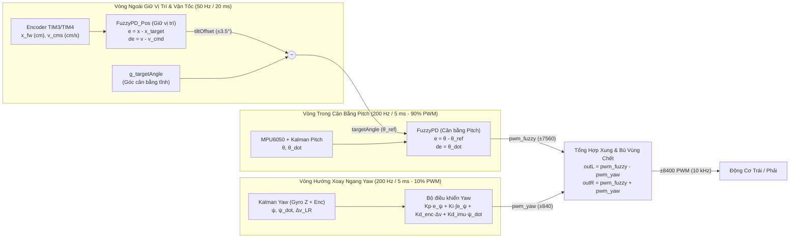

# Hệ Thống Robot Hai Bánh Tự Cân Bằng (TWIP) — STM32F407VG & FreeRTOS

[-03234B?logo=stmicroelectronics)](https://www.st.com/en/microcontrollers-microprocessors/stm32f407vg.html)
[](https://www.freertos.org/)
[](#3-kiến-trúc-điều-khiển-vòng-lồng-cascaded-dual-fuzzy)
[-B71C1C)](./luu_do_dieu_khien_fuzzy.pdf)

Dự án thiết kế và triển khai hệ thống điều khiển **Robot hai bánh tự cân bằng (Two-Wheeled Inverted Pendulum — TWIP)** thời gian thực trên vi điều khiển **STM32F407VGT6** (ARM Cortex-M4F @ 168 MHz) sử dụng hệ điều hành thời gian thực **FreeRTOS**.

Hệ thống kết hợp **Bộ lọc Kalman** đa kênh (Pitch IMU, Yaw hợp nhất Encoder + Gyro Z, và vận tốc 2 bánh xe) cùng **Kiến trúc Điều khiển Mờ Vòng Lồng (Cascaded Dual-Fuzzy Control)** gồm Vòng ngoài giữ vị trí – vận tốc (`FuzzyPD_Pos`, 50 Hz) và Vòng trong cân bằng góc chúc ngóc (`FuzzyPD`, 200 Hz, 90% PWM) phối hợp với bộ điều khiển hướng xoay ngang (`Yaw PID`, 10% PWM).

📄 **Tài liệu bài báo kỹ thuật & lưu đồ thuật toán:** [`luu_do_dieu_khien_fuzzy.pdf`](./luu_do_dieu_khien_fuzzy.pdf) (Mã nguồn LaTeX: [`luu_do_dieu_khien_fuzzy.tex`](./luu_do_dieu_khien_fuzzy.tex))

---

## Mục Lục

1. [Kiến Trúc Phần Cứng & Sơ Đồ Chân (Pinout)](#1-kiến-trúc-phần-cứng--sơ-đồ-chân-pinout)
2. [Cấu Trúc Thư Mục Mã Nguồn](#2-cấu-trúc-thư-mục-mã-nguồn)
3. [Kiến Trúc Điều Khiển Vòng Lồng (Cascaded Dual-Fuzzy)](#3-kiến-trúc-điều-khiển-vòng-lồng-cascaded-dual-fuzzy)
4. [Thiết Kế Bộ Điều Khiển Mờ 5 Khâu (`fuzzy.c`)](#4-thiết-kế-bộ-điều-khiển-mờ-5-khâu-fuzzyc)
5. [Đa Nhiệm Thời Gian Thực (FreeRTOS Tasks)](#5-đa-nhiệm-thời-gian-thực-freertos-tasks)
6. [Giao Thức Truyền Thông UART/DMA & Phần Mềm Giám Sát GUI](#6-giao-thức-truyền-thông-uartdma--phần-mềm-giám-sát-gui)
7. [Hướng Dẫn Biên Dịch, Nạp Firmware & Hiệu Chuẩn](#7-hướng-dẫn-biên-dịch-nạp-firmware--hiệu-chuẩn)

---

## 1. Kiến Trúc Phần Cứng & Sơ Đồ Chân (Pinout)

### Thông số cơ khí & cảm biến
- **Vi điều khiển:** STM32F407VGT6 (168 MHz, tích hợp FPU phần cứng đơn chính xác).
- **Cảm biến quán tính (IMU):** MPU6050 giao tiếp I2C1 (400 kHz Fast-Mode), thang đo Gyroscope $\pm 2000^\circ/\text{s}$, Accelerometer $\pm 2g$.
- **Động cơ & Encoder:** 2 động cơ DC giảm tốc có Encoder cầu phương 2 kênh A/B (`330 PPR` $\times 4 = 1320\text{ xung/vòng}$ ở chế độ `TIM_EncoderMode_TI12`).
- **Kích thước hình học:** Đường kính bánh xe $D = 65\text{ mm}$ (chu vi $C = 20.42\text{ cm}$, hệ số quy đổi $0.01547\text{ cm/xung}$), khoảng cách hai bánh (Wheelbase) $W = 19.21\text{ cm}$.

### Bảng phân bổ ngoại vi và chân GPIO

| Khối Chức Năng | Ngoại Vi STM32 | Chân GPIO | Mô Tả Chi Tiết |
| :--- | :--- | :--- | :--- |
| **IMU MPU6050** | `I2C1` (400 kHz) | `PB8` (SCL), `PB9` (SDA) | Đọc 6 trục Accel/Gyro, tích hợp cơ chế chống treo bus I2C (Bus Recovery) |
| **PWM Động Cơ Trái** | `TIM1_CH1` (10 kHz) | `PA8` (PWM), `PC8` / `PC6` (DIR) | Độ phân giải 8400 mức (`ARR = 8400, PSC = 2`), điều khiển cầu H |
| **PWM Động Cơ Phải** | `TIM1_CH2` (10 kHz) | `PA9` (PWM), `PC9` / `PC7` (DIR) | Độ phân giải 8400 mức ($\approx 0.012\%/\text{bước}$) |
| **Encoder Bánh Trái** | `TIM3` (Encoder x4) | `PA6` (CH1), `PA7` (CH2) | Đếm xung phần cứng 16-bit hai cạnh lên/xuống (`1320 counts/rev`) |
| **Encoder Bánh Phải** | `TIM4` (Encoder x4) | `PB6` (CH1), `PB7` (CH2) | Đếm xung phần cứng 16-bit hai cạnh lên/xuống (`1320 counts/rev`) |
| **Telemetry / Bluetooth** | `USART3` + `DMA1_S3` | `PD8` (TX), `PD9` (RX) | Baudrate `115200 bps`; TX dùng DMA Stream 3 Ch 4, RX dùng ngắt + Ring Buffer |
| **Nút Nhấn Ngoài** | `EXTI0` – `EXTI2` | `PC0` (Start), `PC1` (Stop), `PC2` (Calib) | Ngắt ngoài sườn xuống có lọc chống dội phần mềm (50 ms) |
| **LED Trạng Thái** | `GPIOD` | `PD12` (Xanh), `PD13` (Cam), `PD14` (Đỏ), `PD15` (Lam) | Báo trạng thái RUNNING (`PD12`), CALIB (`PD13`), STOP (`PD14`), FLASH (`PD15`) |
| **Lưu Cấu Hình** | `FLASH Sector 11` | `0x080E0000` (128 KB) | Lưu `targetAngle`, `gyroOffset` và mã kiểm tra toàn vẹn `CRC` |

---

## 2. Cấu Trúc Thư Mục Mã Nguồn

```text
BTL_NMDKTM/
├── MDK_ARM/
│   ├── main.c                      # Điểm vào chương trình, khởi tạo FuzzyPD & FuzzyPD_Pos, chạy FreeRTOS
│   └── template.uvprojx            # Project Keil MDK-ARM uVision 5
├── MY_LIB/
│   ├── fuzzy.c / fuzzy.h           # Bộ điều khiển Mờ 5 khâu tổng quát (FuzzyPD_Compute & FuzzyPD_Compute)
│   ├── kalman.c / kalman.h         # Bộ lọc Kalman góc nghiêng (Pitch/Yaw) & Kalman vận tốc bánh xe
│   ├── pid.c / pid.h               # Bộ điều khiển PID số có chống bão hòa tích phân (Anti-windup)
│   ├── managetask.c / managetask.h # Quản lý 4 Task FreeRTOS, vòng điều khiển Cascade & giao thức UART
│   ├── driver_i2c.c / driver_i2c.h # Driver I2C1 phần cứng & giao tiếp cảm biến MPU6050
│   ├── driver_uart.c / driver_uart.h # Driver USART3 kết hợp DMA1_Stream3 và Ring Buffer RX
│   ├── driver_flash.c / driver_flash.h # Lưu/đọc tham số hiệu chuẩn vào bộ nhớ Flash nội (Sector 11)
│   ├── encoder.c / encoder.h       # Đọc xung Encoder TIM3/TIM4, tính vận tốc RPM và góc Yaw vi sai
│   ├── motor.c / motor.h           # Điều chế xung PWM TIM1 10 kHz (thang ±8400) và điều khiển chiều
│   └── gpio.c / gpio.h             # Cấu hình LED chỉ thị và ngắt ngoài EXTI0..2 cho nút nhấn
├── FreeRTOS/                       # Nhân hệ điều hành thời gian thực FreeRTOS (Cortex-M4F port)
├── Libraries/                      # Thư viện CMSIS & STM32F4xx Standard Peripheral Driver
├── luu_do_dieu_khien_fuzzy.tex     # Mã nguồn LaTeX bài báo kỹ thuật hệ thống điều khiển
├── luu_do_dieu_khien_fuzzy.pdf     # Bản PDF bài báo kỹ thuật & phân tích thực nghiệm
└── README.md                       # Tài liệu hướng dẫn hệ thống
```

---

## 3. Kiến Trúc Điều Khiển Vòng Lồng (Cascaded Dual-Fuzzy)

Hệ thống giải quyết bài toán điều khiển hệ **SIMO phi tuyến bất ổn định** (1 cơ cấu chấp hành bánh xe phải đồng thời giữ cân bằng góc chúc ngóc $\theta$ và giữ vị trí $x$ / vận tốc $v$) thông qua cấu trúc **Điều khiển Vòng Lồng (Cascade Control)**:



### Nguyên lý phối hợp 3 vòng điều khiển
1. **Vòng Ngoài — Giữ Vị Trí & Bám Vận Tốc (`FuzzyPD_Pos`, chu kỳ $T_{\text{outer}} = 20\text{ ms} / 50\text{ Hz}$):**
   - Nhận sai số vị trí dài $e_x = x_{\text{fw}} - x_{\text{target}}\;(\text{cm})$ và sai số vận tốc dài $e_v = v_{\text{cms}} - v_{\text{cmd}}\;(\text{cm/s})$.
   - Điểm đích $x_{\text{target}}$ tự động dịch chuyển mượt theo vận tốc đặt $v_{\text{cmd}}$ và được kẹp chống bão hòa (anti-windup) trong phạm vi $\pm 15\text{ cm}$ quanh vị trí xe hiện tại.
   - Tính toán góc nghiêng đặt bù trừ $\Delta\theta_{\text{tilt}} \in [-3.5^\circ, +3.5^\circ]$, từ đó điều chỉnh góc đặt cho vòng trong:
     $$\theta_{\text{ref}}(k) = \theta_0 - \Delta\theta_{\text{tilt}}(k)$$
2. **Vòng Trong — Cân Bằng Góc Pitch (`FuzzyPD`, chu kỳ $T_{\text{inner}} = 5\text{ ms} / 200\text{ Hz}$):**
   - Nhận góc nghiêng thực tế $\theta = \texttt{g\_filteredPitch}$ và vận tốc góc $\dot{\theta} = \texttt{kalmanPitch.rate}$ từ bộ lọc Kalman.
   - Xuất trực tiếp **90% quỹ công suất PWM** ($\texttt{pwm\_fuzzy} \in [-7560, +7560]$).
3. **Vòng Độc Lập Ngang — Khóa Hướng Xoay Yaw (`Yaw PID`, chu kỳ $5\text{ ms} / 200\text{ Hz}$):**
   - Hợp nhất góc Yaw từ vi sai Encoder và vận tốc góc $\dot{\psi}$ từ trục Z của Gyroscope qua bộ lọc `kalmanYaw`.
   - Xuất tối đa **10% quỹ công suất PWM** ($\texttt{pwm\_yaw} \in [-840, +840]$).
4. **Bù vùng chết bất đối xứng & Giới hạn đạo hàm PWM (Slew-rate Limiter):**
   - Bù vùng chết động theo từng bánh và từng chiều quay (`L_POS = 220`, `L_NEG = 170`, `R_POS = 270`, `R_NEG = 270` trên thang `8400`).
   - Kẹp tốc độ biến thiên xung $\Delta\text{PWM}_{\max} = 900\text{ PWM}/5\text{ms}$ giúp bảo vệ hộp số và tránh trượt bánh.

---

## 4. Thiết Kế Bộ Điều Khiển Mờ 5 Khâu (`fuzzy.c`)

Thư viện [`MY_LIB/fuzzy.c`](./MY_LIB/fuzzy.c) được thiết kế tổng quát hóa theo cấu trúc hướng đối tượng bằng ngôn ngữ C (`FuzzyController_t`), dùng chung cho cả `FuzzyPD` và `FuzzyPD_Pos` với **5 khâu xử lý chuẩn**:

1. **Khâu 1 — Tiền xử lý (`Fuzzy_PreProcess`):**
   Chuẩn hóa sai số $e = y - r$ và đạo hàm $de = \dot{y}$ về miền cơ sở $[-1.0, +1.0]$ thông qua hệ số tỉ lệ $k_e, k_{de}$.
2. **Khâu 2 — Mờ hóa (`Fuzzy_Fuzzify`):**
   Ánh xạ $(e_{\text{norm}}, de_{\text{norm}})$ vào 5 tập mờ đầu vào $\{\text{NB}, \text{NS}, \text{ZE}, \text{PS}, \text{PB}\}$. Tập $\text{ZE}$ sử dụng hàm liên thuộc **Hình thang cân** có đáy phẳng $[-z_e, +z_e]$ giúp triệt tiêu hiện tượng rung tần số cao (chattering) quanh điểm cân bằng.
3. **Khâu 3 — Suy diễn mờ (`Fuzzy_Inference`):**
   Đánh giá ma trận **25 luật mờ ($5 \times 5$)** ánh xạ sang 7 trạng thái đầu ra $\{\text{NB}, \text{NM}, \text{NS}, \text{ZE}, \text{PS}, \text{PM}, \text{PB}\}$ theo toán tử tích đại số Larsen ($w_{i,j} = \mu_e[i] \cdot \mu_{de}[j]$).
4. **Khâu 4 — Giải mờ (`Fuzzy_Defuzzify`):**
   Tính trung bình có trọng số (Weighted Average / Takagi–Sugeno bậc 0) trên 7 giá trị Singleton đối xứng $\{-1.0, -u_m, -u_s, 0, +u_s, +u_m, +1.0\}$.
5. **Khâu 5 — Hậu xử lý (`Fuzzy_PostProcess`):**
   Khuếch đại tín hiệu chuẩn hóa qua hệ số $k_u$ và kẹp bão hòa trong dải vật lý $[u_{\min}, u_{\max}]$.

### Bảng thông số cấu hình thực tế trong `main.c`

| Tham Số | `FuzzyPD` (Vòng Trong Pitch — 200 Hz) | `FuzzyPD_Pos` (Vòng Ngoài Vị Trí/Vận Tốc — 50 Hz) |
| :--- | :--- | :--- |
| **Hệ số chuẩn hóa $k_e$** | $1/12.0 \approx 0.0833\;\text{độ}^{-1}$ (bão hòa ở $\pm 12^\circ$) | $0.024\;\text{cm}^{-1}$ (bão hòa ở $\pm 41.7\text{ cm}$) |
| **Hệ số chuẩn hóa $k_{de}$** | $1/720.0 \approx 0.00139\;(\text{độ/s})^{-1}$ (bão hòa ở $\pm 720^\circ/\text{s}$) | $0.034\;(\text{cm/s})^{-1}$ (bão hòa ở $\pm 29.4\text{ cm/s}$) |
| **Hệ số khuếch đại $k_u$** | $7560.0\text{ PWM}$ (90% công suất động cơ) | $3.30^\circ$ (góc nghiêng đặt bù trừ) |
| **Giới hạn bão hòa đầu ra** | $[-7560.0,\; +7560.0]\text{ PWM}$ | $[-3.50^\circ,\; +3.50^\circ]$ |
| **Mốc hàm liên thuộc $e$** | $\text{NB}=0.50,\; \text{NS}=0.20,\; \text{ZE}_{\text{flat}}=0.002$ | $\text{NB}=0.39,\; \text{NS}=0.09,\; \text{ZE}_{\text{flat}}=0.001$ |
| **Mốc hàm liên thuộc $de$** | $\text{NB}=0.50,\; \text{NS}=0.25,\; \text{ZE}_{\text{flat}}=0.002$ | $\text{NB}=0.48,\; \text{NS}=0.25,\; \text{ZE}_{\text{flat}}=0.020$ |
| **Singleton đầu ra $(u_s, u_m)$** | $u_{\text{small}} = 0.28,\; u_{\text{med}} = 0.64$ | $u_{\text{small}} = 0.28,\; u_{\text{med}} = 0.56$ |

---

## 5. Đa Nhiệm Thời Gian Thực (FreeRTOS Tasks)

Hệ thống được phân chia thành 4 tác vụ lập lịch ưu tiên (Preemptive Scheduling) với chu kỳ cố định qua `vTaskDelayUntil`:

| Tên Task | Độ Ưu Tiên | Chu Kỳ ($f_s$) | Stack | Chức Năng Chính |
| :--- | :---: | :---: | :---: | :--- |
| `vTaskControl` | **4 (Cao nhất)** | $5\text{ ms}$ ($200\text{ Hz}$) | 1024 words | Thực thi vòng ngoài `FuzzyPD_Pos` (mỗi 4 chu kỳ = $20\text{ ms}$), vòng trong `FuzzyPD`, vòng `Yaw PID`, bù vùng chết và xuất PWM |
| `vTaskIMU` | **3** | $5\text{ ms}$ ($200\text{ Hz}$) | 512 words | Đọc MPU6050 qua I2C1, tính góc Pitch thô, cập nhật bộ lọc `kalmanPitch` và hợp nhất `kalmanYaw` |
| `vTaskEncoder` | **3** | $5\text{ ms}$ ($200\text{ Hz}$) | 512 words | Đọc bộ đếm phần cứng TIM3/TIM4, lọc vận tốc `kalmanSpeed_L/R`, tích lũy tổng xung vị trí và góc Yaw vi sai |
| `vTaskUART` | **2** | $10\text{ ms}$ ($100\text{ Hz}$) | 512 words | Giải mã khung lệnh điều khiển từ PC/Bluetooth và phát gói Telemetry 88-byte bằng DMA ở tần số $50\text{ Hz}$ |

---

## 6. Giao Thức Truyền Thông UART/DMA & Phần Mềm Giám Sát GUI

Khung truyền nhị phân tốc độ cao trên `USART3` (`115200 bps`):
```text
[Header: 0xAA] [ID: 1 byte] [Length: 1 byte] [Payload: N bytes] [Checksum: 1 byte] [Tail: 0xFF]
```
*(Trong đó `Checksum = ID | Length | Data[0] | ... | Data[N-1]`)*

### Các gói dữ liệu từ STM32 gửi lên PC (TX DMA)
- **`ID = 0x01` (`RobotTelemetry_t` — 88 bytes = 22 biến `float`, tần số 50 Hz):**
  Gồm góc `rawPitch`, `filteredPitch`, `gyroRate`, `rawYaw`, `filteredYaw`, `yawRate`, vận tốc bánh xe `Raw/Kalman L/R`, `PWM L/R`, `targetAngle`, `outFuzzy`, `outYaw`, `outSpeed`, cùng 6 biến chẩn đoán chuyên sâu của bộ Mờ (`velCmd`, `dVel`, `pitchENorm`, `pitchDeNorm`, `posENorm`, `posDeNorm`).
- **`ID = 0x02` (`RobotConfigSync_t` — 64 bytes = 16 biến `float`):**
  Đồng bộ toàn bộ thông số PID, góc cân bằng tĩnh `targetAngle`, chế độ điều khiển và 6 hệ số tỉ lệ `(ke, kde, ku)` của `FuzzyPD` & `FuzzyPD_Pos` lên giao diện máy tính.

### Các mã lệnh từ PC gửi xuống STM32 (RX Interrupt)
- `0x01`: **START** — Kích hoạt chế độ điều khiển cân bằng.
- `0x02`: **STOP** — Ngắt động cơ an toàn và xóa trạng thái tích phân.
- `0x03`: **AUTO CALIB** — Lấy mẫu trung bình 200 mẫu IMU, xác định `targetAngle` và `gyroOffset`, lưu vào Flash Sector 11.
- `0x04` – `0x08`: Cập nhật trực tiếp góc cân bằng gốc, vận tốc đặt, góc hướng đích Yaw, chế độ điều khiển (`Dual-PID` / `Fuzzy`) và bộ hệ số PID.
- `0x09`: Yêu cầu đồng bộ lại gói cấu hình `0x02`.
- `0x0A`: **LIVE FUZZY TUNING** — Nạp nóng 6 hệ số `(ke, kde, ku)` của `FuzzyPD` và `FuzzyPD_Pos` trong lúc xe đang chạy mà không cần biên dịch lại firmware.

---

## 7. Hướng Dẫn Biên Dịch, Nạp Firmware & Hiệu Chuẩn

### 7.1. Biên dịch và nạp chương trình
1. Mở project [`MDK_ARM/template.uvprojx`](./MDK_ARM/template.uvprojx) bằng **Keil MDK-ARM uVision 5** (hoặc dùng dòng lệnh):
   ```powershell
   C:\Keil_v5\UV4\UV4.exe -b MDK_ARM\template.uvprojx -j0
   ```
2. Kết nối mạch nạp **ST-Link V2** với board STM32F407VG Discovery và nhấn **Download (F8)**.
   *(Lưu ý: Trong mục Flash Download của Keil, chọn **Erase Sectors** thay vì Erase Full Chip để giữ lại dữ liệu hiệu chuẩn ở Sector 11).*

### 7.2. Quy trình vận hành & hiệu chuẩn nhanh
1. **Hiệu chuẩn điểm cân bằng tĩnh (Chỉ cần thực hiện khi thay đổi kết cấu cơ khí):**
   - Giữ xe đứng thẳng tại vị trí cân bằng tự nhiên, nhấn nút **Calib (`PC2`)** trên mạch hoặc nút **⚖ CALIB** trên phần mềm GUI.
   - Đèn LED Cam (`PD13`) sáng trong quá trình lấy mẫu 200 điểm, sau đó đèn LED Xanh Dương (`PD15`) nháy báo hiệu đã lưu thành công vào Flash.
2. **Khởi chạy cân bằng:**
   - Đặt xe đứng gần vị trí cân bằng, nhấn nút **Start (`PC0`)** hoặc nút **▶ START** trên GUI. Đèn LED Xanh Lá (`PD12`) bật sáng, xe tự động giữ cân bằng và khóa vị trí tại chỗ.
   - Nếu xe bị nghiêng quá giới hạn an toàn $\pm 15^\circ$, hệ thống tự động ngắt PWM (`Robot_Stop()`) và bật đèn LED Đỏ (`PD14`).

